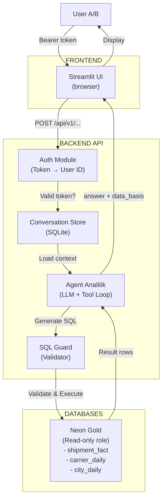
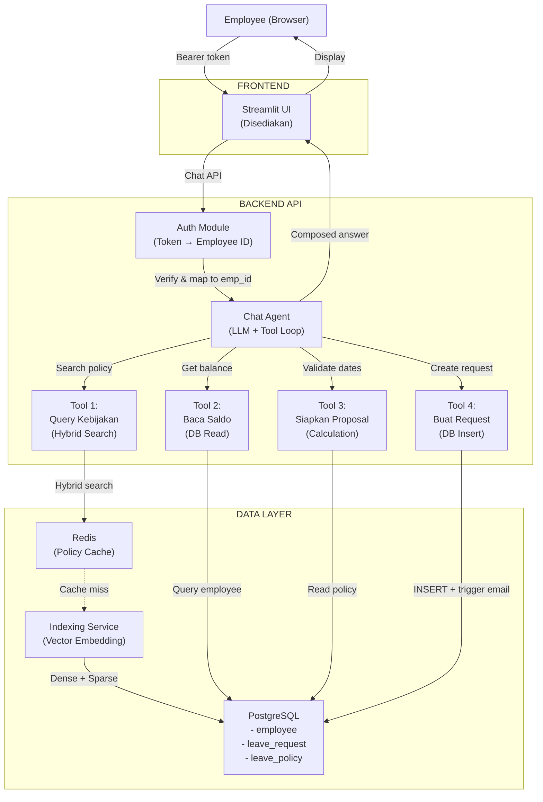

# Analisis Dua Pilihan Milestone Phase 2

**Tanggal:** November 2026  
**Durasi:** 3 sesi mentoring × 180 menit + demo 5–7 menit per milestone  
**Level:** Intermediate

---

## 📊 Perbandingan Cepat

| Aspek | Analytics-Agent | HR-Agent |
|---|---|---|
| **Fokus Utama** | Agent analitik data pengiriman paket | Agent kebijakan HR & manajemen cuti |
| **Domain** | Operasi logistik | Human Resources |
| **Sumber Materi** | Week 05 Day 4-5 & Week 06 Day 4-5 | Week 05 Day 4-5 & Week 06 Day 3 & 4-5 |
| **Kompleksitas Query** | Multi-step analytics (aggregation, filtering, trending) | Policy retrieval + structured data (balance, request) |
| **Tipe Tool** | SQL SELECT & validation | Hybrid search + 4-tool agent |
| **Database** | Neon (Gold hanya baca) | PostgreSQL + Redis |
| **Key Challenge** | SQL guard & data lineage | Policy retrieval + state management |

---

## 🏗️ MILESTONE 1: ANALYTICS-AGENT — Pengiriman Paket

### 1️⃣ Deskripsi Singkat

Membangun backend API dengan **AI Agent** yang menjawab pertanyaan analitik pengiriman paket dalam bahasa alami. Sistem mengubah pertanyaan pengguna menjadi SQL SELECT terstruktur, mengambil data dari Neon, dan memberikan jawaban dengan dasar data yang jelas dan terukur.

**Contoh pertanyaan yang ditangani:**
- "Berapa jumlah kiriman pada Agustus 2026?"
- "Carrier mana yang paling tepat waktu pada bulan tersebut?"
- "Bagaimana tren kiriman ke Bandung per minggu?"
- "Berapa refund rate untuk layanan express?"

### 2️⃣ Apa yang Harus Dibangun

#### A. **Backend API (FastAPI/Flask)**
- Endpoint health check: `/healthz`
- Endpoint percakapan: 
  - `POST /api/v1/conversations` (buat percakapan baru)
  - `GET /api/v1/conversations` (list percakapan milik user)
  - `GET /api/v1/conversations/{id}` (baca satu percakapan)
  - `POST /api/v1/conversations/{id}/messages` (kirim pesan/pertanyaan)

#### B. **Autentikasi & Otorisasi**
- Verifikasi bearer token demo (2 token: User A, User B)
- Server-side identity mapping (token → user_id)
- Pemeriksaan kepemilikan percakapan sebelum akses

#### C. **Agent Analitik**
- **Input:** Pertanyaan dalam bahasa natural
- **Processing:** 
  - Pahami intent pertanyaan
  - Generate SQL SELECT (hanya baca)
  - Validasi SQL sebelum eksekusi
- **Output:** Jawaban dengan angka, unit, periode, filter, dan dasar data

#### D. **SQL Guard & Validasi**
- Whitelist tabel: `gold.shipment_fact`, `gold.carrier_daily`, `gold.city_daily`
- Whitelist kolom per tabel
- Validasi query:
  - Hanya `SELECT` saja
  - Tanpa `INSERT`, `UPDATE`, `DELETE`
  - Tanpa akses schema lain
  - Batas eksekusi (timeout, max rows, result size)

#### E. **Penyimpanan Percakapan**
- SQLite lokal untuk menyimpan histori chat
- Context management untuk follow-up questions
- Isolation per user

#### F. **Docker & Reproducibility**
- `Dockerfile` untuk API dan UI
- `docker-compose.yaml` dengan service API (port 8000) dan UI (port 8501)
- Named volume untuk SQLite persistence

### 3️⃣ Arsitektur Sistem



**Flow Detail:**

```
1. User Task: "Berapa jumlah kiriman Agustus 2026?"
                    ↓
2. Streamlit UI → POST /api/v1/conversations/{id}/messages
   Body: {"message": "..."}
   Header: {"Authorization": "Bearer sk-demo-a-xxxxx"}
                    ↓
3. Backend API Auth
   ├─ Validate token → user_id = "user_a"
   ├─ Check conversation ownership
   └─ Load percakapan & context
                    ↓
4. Agent Analitik (LLM)
   Input: [Percakapan history] + Question
   ├─ Understand intent
   ├─ Plan SQL
   └─ Generate: "SELECT COUNT(*) FROM gold.shipment_fact 
                 WHERE order_date >= '2026-08-01' 
                 AND order_date <= '2026-08-31'"
                    ↓
5. SQL Guard Validator
   ├─ Is SELECT only? ✓
   ├─ Tables in whitelist? ✓
   ├─ Columns in whitelist? ✓
   ├─ No DDL/DML? ✓
   ├─ Timeout & row limit? ✓
   └─ Return: SAFE or REJECT
                    ↓
6. Execute on Neon (Read-only role)
   Result: [{count: 12345}]
                    ↓
7. Agent composes answer
   "Jumlah kiriman pada Agustus 2026 adalah 12.345 paket
    berdasarkan tabel gold.shipment_fact dengan filter
    order_date antara 1-31 Agustus 2026."
                    ↓
8. Response to UI
   {
     "answer": "...",
     "data_basis": {...},
     "outcome": "answered"
   }
                    ↓
9. Streamlit displays answer
                    ↓
10. User follow-up (dalam percakapan yang sama)
    Context dari sebelumnya tersedia → Agent lebih mudah memahami
```

### 4️⃣ Data & Tabel yang Digunakan

**Database:** Neon PostgreSQL (role hanya baca)  
**Periode:** 1 Juli – 20 September 2026

| Tabel | Grain | Kolom Utama |
|---|---|---|
| `gold.shipment_fact` | 1 baris per shipment | `shipment_id`, `order_date`, `delivery_date`, `service_level`, `carrier`, `city_destination`, `status`, `refund_amount`, `exception_note` |
| `gold.carrier_daily` | 1 baris per tanggal + carrier | `metric_date`, `carrier`, `orders_count`, `on_time_count`, `late_count` |
| `gold.city_daily` | 1 baris per tanggal + kota | `metric_date`, `city`, `orders_count`, `on_time_count`, `late_count` |

### 5️⃣ Sumber Materi dari 10 Hari Pembelajaran

| Hari | Materi | Relevansi ke Milestone |
|---|---|---|
| **Week 05 Day 1** | AI Gateway (OmniRoute) | Opsional: arsitektur proxy untuk multiple agents |
| **Week 05 Day 2** | Prompt Technique & Optimization | ✅ **Prompting strategy untuk SQL generation** |
| **Week 05 Day 3** | Vector Database (Pinecone) | Opsional: jika dokumentasi diabstrakkan sebagai vector |
| **Week 05 Day 4** | RAG dengan LangChain | ✅ **Agent loop, tool execution, context management** |
| **Week 05 Day 5** | Reliability Layer & Function Calling | ✅ **Validasi input, retry, fallback, authorization** |
| **Week 06 Day 1** | RAG untuk Data Terstruktur | ✅✅ **UTAMA: Text-to-SQL, database access pattern** |
| **Week 06 Day 2** | Lab RAG RuangKarya | Opsional: edge case handling dalam retrieval |
| **Week 06 Day 3** | Consuming & Presenting AI Output | ✅ **Output validation, JSON schema, grounding** |
| **Week 06 Day 4** | AI Agent Part 1 | ✅✅ **UTAMA: reasoning loop, tool integration, SQL guard** |
| **Week 06 Day 5** | AI Agent Part 2 (CrewAI) | Opsional: multi-agent orchestration |

**Materi Kunci:** Week 06 Day 1, Day 3, dan Day 4

---

## 🏥 MILESTONE 2: HR-AGENT — Kebijakan HR & Cuti

### 1️⃣ Deskripsi Singkat

Membangun backend FastAPI dengan **AI Agent** yang menjawab pertanyaan kebijakan HR dan mengelola permintaan cuti. Sistem menggabungkan hybrid search (vector embedding + BM25) untuk menemukan kebijakan yang relevan, dan tool khusus untuk membaca saldo cuti, menyiapkan proposal, serta membuat permintaan yang pending approval.

**Contoh kasus yang ditangani:**
- "Berapa quota cuti tahunan saya?"
- "Apakah saya bisa mengambil cuti unpaid?"
- "Berapa saldo cuti saya sekarang?"
- "Saya ingin mengajukan cuti dari 10-14 November, bisa?"

### 2️⃣ Apa yang Harus Dibangun

#### A. **Backend API (FastAPI)**
- Endpoint health check
- Endpoint untuk UI Streamlit yang sudah disediakan
- Authentikasi bearer token (identitas dari backend)
- Endpoint chatbot dengan tool loop

#### B. **Hybrid Retrieval untuk Kebijakan**
- **Dense Search:** Vector embedding dari dokumen kebijakan (OpenAI Embeddings)
- **Sparse Search:** BM25 untuk keyword matching
- **Indexing:** Menyimpan embedding pada PostgreSQL atau Redis
- **Query:** Mencari kebijakan yang relevan untuk setiap pertanyaan

#### C. **Agent 4-Tool**
Tool 1: **Query Kebijakan** (Hybrid Search)
- Input: Pertanyaan tentang kebijakan HR
- Output: Daftar dokumen relevan dengan sitasi

Tool 2: **Baca Saldo Cuti** (Database Query)
- Input: User ID (dari token, bukan input)
- Output: Saldo annual leave, sick leave, unpaid leave per karyawan

Tool 3: **Siapkan Proposal Cuti** (Calculation)
- Input: Tanggal mulai, tanggal selesai, tipe cuti
- Output: Rekomendasi proposal yang valid berdasarkan kebijakan & saldo

Tool 4: **Buat Permintaan Cuti** (Database Insert)
- Input: Detail proposal dari tool 3
- Output: Request ID dengan status `pending_manager_review`
- Constraint: **TIDAK ada approval otomatis**, hanya pending

#### D. **Aturan Cuti & Validasi**
- Annual leave, sick leave, unpaid leave
- Kebijakan min/max hari per tipe
- Carry-over rules
- Blackout dates (jika ada)
- Manager review workflow

#### E. **PostgreSQL Repository Pattern**
- `Employee` table: nama, department, saldo cuti
- `LeaveRequest` table: request, status, approver
- `LeavePolicy` table: kebijakan dan aturan
- **Authorization:** Hanya bisa baca/ubah data pribadi sendiri

#### F. **Docker & Reproducibility**
- `Dockerfile` untuk API dan UI
- `docker-compose.yml` dengan 4 service:
  - API (port 8000)
  - UI (port 8501)
  - PostgreSQL database
  - Redis (optional: untuk caching policy vector)

### 3️⃣ Arsitektur Sistem



**Flow Detail:**

```
1. Employee Task: "Berapa saldo cuti tahunan saya?"
   Header: Authorization: Bearer sk-demo-emp-xxxxx
                    ↓
2. Backend Auth
   ├─ Validate token → emp_id = 12345
   ├─ Load employee record
   └─ Set context
                    ↓
3. Chat Agent (LLM)
   Input: [Chat history] + Question
   ├─ Understand intent: "Query balance"
   ├─ Available tools: [Query Policy, Read Balance, 
                        Prepare Proposal, Create Request]
   └─ Decide: Use "Read Balance"
                    ↓
4. Tool 2: Read Balance
   Input: emp_id=12345 (from auth, not user input)
   Query: SELECT * FROM employee 
          WHERE emp_id = 12345
   Output: {
     annual_leave: 15,
     sick_leave: 5,
     unpaid_leave: unlimited
   }
                    ↓
5. Agent Composes Answer
   "Saldo cuti Anda adalah:
    - Cuti Tahunan: 15 hari
    - Cuti Sakit: 5 hari
    - Cuti Unpaid: Unlimited"
                    ↓
6. Response to UI
   {
     "answer": "...",
     "tool_used": ["Read Balance"],
     "citations": [...],
     "status": "answered"
   }
                    ↓
7. Employee Follow-up:
   "Saya ingin ambil cuti 10-14 Nov untuk jenis tahunan"
                    ↓
8. Chat Agent
   Intent: "Create leave request"
   ├─ Tool 3: Prepare Proposal
   │   Input: dates=[10-14], type=annual, emp_id=12345
   │   Validate: saldo cukup? date sudah terlewat? blackout?
   │   Output: {
   │     dates: valid,
   │     duration: 5,
   │     type: annual,
   │     balance_after: 10
   │   }
   ├─ Tool 4: Create Request
   │   Input: proposal (dari Tool 3)
   │   INSERT: leave_request with status = 'pending_manager_review'
   │   Output: request_id = "REQ-2026-11-001"
   └─ Compose: "Permintaan cuti dibuat dengan nomor REQ-2026-11-001.
               Menunggu persetujuan manager."
                    ↓
9. Response to UI
   {
     "answer": "Permintaan dibuat...",
     "tool_used": ["Prepare Proposal", "Create Request"],
     "request_id": "REQ-2026-11-001",
     "status": "pending_manager_review"
   }
```

### 4️⃣ Hybrid Search untuk Kebijakan

**Dense Vector Search (Semantic):**
```
"Berapa hari cuti tahunan?" 
    ↓
OpenAI Embeddings (text-embedding-3-small)
    ↓
Vector search di PostgreSQL (pgvector extension)
    ↓
Top-k similar policies
```

**Sparse Search (Keyword):**
```
"Berapa hari cuti tahunan?"
    ↓
BM25 tokenization
    ↓
Keyword match di policy documents
    ↓
Top-k matching documents
```

**Fusion (RRF - Reciprocal Rank Fusion):**
- Gabungkan top-k dari dense + sparse
- Score = 1/(rank_dense+1) + 1/(rank_sparse+1)
- Rerank by combined score

### 5️⃣ Data Schema

**PostgreSQL Tables:**

```sql
-- Karyawan
CREATE TABLE employee (
  emp_id SERIAL PRIMARY KEY,
  name VARCHAR,
  department VARCHAR,
  annual_leave_balance INT,
  sick_leave_balance INT,
  -- ... other fields
);

-- Permintaan Cuti
CREATE TABLE leave_request (
  request_id SERIAL PRIMARY KEY,
  emp_id INT,
  start_date DATE,
  end_date DATE,
  leave_type VARCHAR,
  status VARCHAR, -- pending_manager_review, approved, rejected
  created_at TIMESTAMP,
  -- ... other fields
);

-- Kebijakan Cuti (diindex untuk hybrid search)
CREATE TABLE leave_policy (
  policy_id SERIAL PRIMARY KEY,
  content TEXT,
  embedding VECTOR(1536), -- pgvector untuk dense search
  category VARCHAR,
  updated_at TIMESTAMP
);
```

### 6️⃣ Sumber Materi dari 10 Hari Pembelajaran

| Hari | Materi | Relevansi ke Milestone |
|---|---|---|
| **Week 05 Day 1** | AI Gateway | Opsional: load balancing jika multiple agents |
| **Week 05 Day 2** | Prompt Technique | ✅ **Strategy untuk classification & proposal logic** |
| **Week 05 Day 3** | Vector Database (Pinecone) | ✅ **Embedding & search, tapi pakai PostgreSQL pgvector** |
| **Week 05 Day 4** | RAG dengan LangChain | ✅ **Agent loop, tool calling, context** |
| **Week 05 Day 5** | Reliability & Function Calling | ✅✅ **UTAMA: Validation, authorization, retry** |
| **Week 06 Day 1** | RAG Data Terstruktur | ✅ **Database queries, schema handling** |
| **Week 06 Day 2** | Lab RAG RuangKarya | ✅ **Hybrid search pattern (dense + BM25)** |
| **Week 06 Day 3** | Consuming Output | ✅ **Output validation, structured responses, sitasi** |
| **Week 06 Day 4** | AI Agent Part 1 | ✅✅ **UTAMA: Tool loop, state machine, guardrail** |
| **Week 06 Day 5** | AI Agent Part 2 (CrewAI) | ✅ **Multi-tool orchestration, task sequencing** |

**Materi Kunci:** Week 05 Day 5, Week 06 Day 2, 3, 4, 5

---

## 🔄 Perbandingan Detail

### Kompleksitas

| Dimensi | Analytics-Agent | HR-Agent |
|---|---|---|
| **Query Generation** | Simple: SQL SELECT dari pertanyaan | Medium: Schema variabel per tool |
| **Validation** | Complex: SQL guard dengan whitelist | Medium: Policy validation + date logic |
| **Tool Loop** | Simple: 1 tool (SQL execute) | Complex: 4 tool dengan sequence |
| **Authorization** | Simple: Percakapan ownership | Medium: Employee self-access + manager role |
| **State Management** | Simple: Conversation history | Medium: Follow-up + request status tracking |
| **Retrieval** | Simple: Direct table query | Complex: Hybrid search (dense + sparse) |

### Kesulitan Teknis

**Analytics-Agent:**
- ✅ SQL generation & validation (high risk)
- ✅ Data lineage & grounding (evidence required)
- ⚠️ Follow-up context dalam multi-step analytics
- ⚠️ Aggregation logic (grouping, filtering, trending)

**HR-Agent:**
- ✅ Hybrid search implementation (vector + BM25)
- ✅ Multi-tool orchestration & sequencing
- ✅ Authorization & state management
- ⚠️ Policy interpretation (sitasi, ambiguity)
- ⚠️ Business rule validation (date, balance, blackout)

### Sumber Materi Dominan

| Milestone | Hari Dominan | Alasan |
|---|---|---|
| Analytics | Week 06 Day 1, 4 | Text-to-SQL dan reasoning loop untuk analytics |
| HR | Week 06 Day 2, 4, 5 | Hybrid search, multi-tool, agent orchestration |

---

## 📋 Checklist Pemilihan

**Pilih Analytics-Agent jika Anda:**
- ✅ Tertarik dengan query optimization dan SQL validation
- ✅ Ingin mendalami data analytics & business metrics
- ✅ Suka debugging SQL dan data lineage
- ✅ Pertanyaan cenderung exploratory & multi-dimensional

**Pilih HR-Agent jika Anda:**
- ✅ Tertarik dengan workflow dan state management
- ✅ Ingin mendalami hybrid search & vector embeddings
- ✅ Suka berhadapan dengan business rules & conditional logic
- ✅ Pertanyaan cenderung transactional & sequential
- ✅ Ingin belajar lebih banyak tentang orchestration multi-tool

---

## 🎯 Rekomendasi

### Analytics-Agent Cocok Untuk:
- Data engineer yang ingin belajar LLM-driven BI
- Orang yang sudah solid di SQL dan ingin eksplorasi AI
- Yang interested di production RAG + safety layers

### HR-Agent Cocok Untuk:
- Backend developer yang ingin belajar agent orchestration
- Orang yang interested di complex workflows & state machines
- Yang ingin deeper dive ke multi-tool agent patterns
- Lebih praktik enterprise application patterns

---

## 📞 Support & Resources

**Keduanya memerlukan:**
- Akun LLM provider (OpenAI, Anthropic, atau Gemini)
- Database (Neon untuk Analytics / PostgreSQL untuk HR)
- 3 × 180 menit mentoring terstruktur
- Checkpoint setiap sesi

**Dokumentasi tambahan tersedia di folder masing-masing:**
- `brief.md` - Kontrak API & requirement lengkap
- `gold-contract.md` (Analytics) / `lab.md` (HR) - Data schema
- `public-checks.md` / `assessment.md` - Test cases
- `rubric.md` - Penilaian 100 poin
- `submission-checklist.md` - Checklist sebelum submit

---

**Pilihan tergantung interest Anda. Keduanya equally challenging dan valuable! 🚀**
