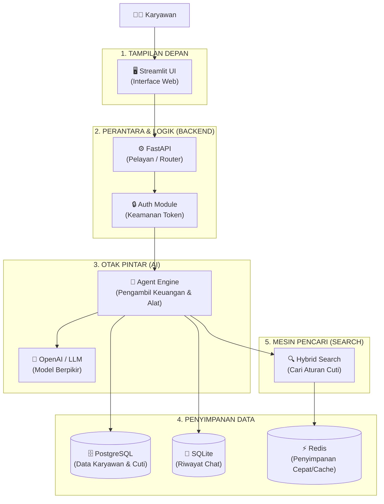

# Panduan Tech Stack HR-Agent (Untuk Awam)

## 🏠 Analogi Rumah Sederhana

Bayangkan sistem HR-Agent ini seperti **Restoran Pintar**:

- **Tampilan (Streamlit):** Meja dan Menu Restoran (tempat pelanggan melihat dan pesan)
- **Pelayan (FastAPI):** Pelayan yang mengambil pesanan dan mengantar makanan
- **Koki Pintar (LLM / OpenAI):** Koki yang berpikir dan memutuskan resep apa yang digunakan
- **Buku Resep (Vector Search):** Buku petunjuk aturan restoran (kebijakan cuti)
- **Gudang Bahan (PostgreSQL):** Tempat menyimpan data pelanggan (saldo cuti & riwayat)
- **Buku Catatan (SQLite):** Catatan percakapan meja per meja
- **Kotak Es (Redis):** Tempat menyimpan bahan es batu (caching biar cepat)
- **Wadah Pengiriman (Docker):** Kontainer khusus untuk membawa seluruh restoran sekaligus

---

## 🧩 7 Komponen Utama Tech Stack



---

## 🔍 Penjelasan Detail Per Komponen

### 1️⃣ **Streamlit (Tampilan Depan / Web UI)**
- **Apa itu?** Layar yang Anda lihat di web browser.
- **Tugasnya:** Tempat Anda mengetik pertanyaan ("Berapa sisa cuti saya?") dan melihat jawaban AI.
- **Analogi:** Layar Kasir / Buku Menu di restoran.
- **Bahasanya:** Python (dibuat cepat tanpa perlu HTML/CSS rumit).

---

### 2️⃣ **FastAPI (Pintu Gerbang Backend)**
- **Apa itu?** Program backend yang menghubungkan Layar Web ke Otak AI & Database.
- **Tugasnya:**
  - Memeriksa apakah Anda pengguna sah (Security Guard)
  - Menerima pertanyaan Anda dari Web UI
  - Meneruskan ke Otak AI
  - Mengembalikan jawaban ke Web UI
- **Analogi:** Pelayan restoran yang mengantar pesan dari meja ke dapur.
- **Keunggulan:** Sangat cepat dan aman.

---

### 3️⃣ **OpenAI / LLM (Otak Pemikir AI)**
- **Apa itu?** Kuis/Model AI cerdas berbasis cloud (subscription seperti ChatGPT).
- **Tugasnya:**
  - Memahami arti pertanyaan Anda
  - Memilih **alat (tool)** mana yang perlu dipakai:
    - Alat 1: Cari aturan cuti
    - Alat 2: Cek saldo cuti Anda
    - Alat 3: Buat draft pengajuan
    - Alat 4: Simpan ke database
  - Menyusun jawaban dalam bahasa manusia yang ramah.
- **Analogi:** Koki Utama di dapur yang pintar dan fleksibel.

---

### 4️⃣ **PostgreSQL (Database Utama System HR)**
- **Apa itu?** Tempat penyimpanan data resmi yang rapi dan terstruktur.
- **Tugasnya:**
  - Menyimpan data karyawan (Nama, Saldo Cuti, Departemen)
  - Menyimpan pengajuan cuti yang sudah dibuat
  - Menyimpan dokumen kebijakan HR
- **Analogi:** Lemari Arsip Kantor / Gudang Bahan Makanan Restoran.
- **Sifatnya:** Sangat aman, data tidak hilang walau server mati.

---

### 5️⃣ **SQLite (Pencatat Percakapan Chat)**
- **Apa itu?** Database kecil yang menempel langsung di program.
- **Tugasnya:** Menyimpan **riwayat percakapan (chat history)** Anda dengan AI.
- **Analogi:** Buku catatan kecil pelayan untuk mengingat apa yang Anda pesan sebelumnya.
- **Kenapa dipisah dari PostgreSQL?** Biar cepat dan percakapan tidak mengotori data utama perusahaan.

---

### 6️⃣ **Hybrid Search / Vector Engine (Pencari Aturan)**
- **Apa itu?** Teknologi mesin pencari pintar yang menggabungkan dua cara cari:
  - **Cari kata kunci (BM25):** Cari kata persis ("cuti", "melahirkan")
  - **Cari makna (Vector):** Cari arti yang mirip ("libur", "istirahat", "off")
- **Tugasnya:** Menemukan pasal atau aturan cuti yang paling tepat dalam detik.
- **Analogi:** Pustakawan yang langsung tahu di buku mana dan halaman berapa aturan itu ada.

---

### 7️⃣ **Docker (Wadah Pembungkus / Shipping Container)**
- **Apa itu?** Alat untuk membungkus **SEMUA** program di atas jadi satu paket siap pakai.
- **Tugasnya:** Memastikan aplikasi berjalan **SAMA PERSIS** di laptop Anda, laptop teman, maupun di server cloud.
- **Analogi:** Kontainer kapal laut — apa pun isinya, bisa langsung diangkut dan dibuka di mana saja tanpa rusak.
- **Keuntungan:** Tidak ada masalah "di laptop saya bisa, di laptop kamu error".

---

## 🔄 Bagaimana Semua Bekerja Bersama? (Alur Sederhana)

```
[Anda] Ketik: "Saya mau cuti tanggal 10-14 Nov"
  ↓
[Streamlit] Kirim ke Backend API
  ↓
[FastAPI] Cek Token Keamanan (Sah/Bukan?)
  ↓
[Agent LLM] Berpikir: "Oh, ini mau ajukan cuti!"
  ├─ Pakai Alat 1: Cek saldo di [PostgreSQL] → Saldo masih 15 hari (Cukup!)
  ├─ Pakai Alat 2: Cek aturan di [Hybrid Search] → Tanggal valid, tidak ada aturan dilanggar
  ├─ Pakai Alat 3: Buat draft proposal
  └─ Pakai Alat 4: Simpan status 'Pending Approval' di [PostgreSQL]
  ↓
[SQLite] Simpan percakapan ini ke riwayat
  ↓
[FastAPI] Mengirim jawaban ke [Streamlit]
  ↓
[Anda] Melihat jawaban: "Pengajuan cuti 10-14 Nov telah dibuat (Pending Review Manager)"
```

---

## 💰 Biaya & Kebutuhan Tambahan

| Komponen | Status Biaya | Catatan |
|---|---|---|
| **Streamlit** | Gratis (Open Source) | Berjalan di komputer lokal |
| **FastAPI** | Gratis (Open Source) | Berjalan di komputer lokal |
| **OpenAI API** | **Berbayar (Pay-per-use)** | Sekitar $0.001 - $0.01 per pertanyaan |
| **PostgreSQL** | Gratis (Open Source) | Berjalan lewat Docker |
| **SQLite** | Gratis | Sudah bawaan Python |
| **Redis** | Gratis (Open Source) | Berjalan lewat Docker (Opsional) |
| **Docker** | Gratis (Desktop version) | Aplikasi pembungkus |

---

## 💡 Ringkasan 5 Komponen Utama Paling Penting

1. **Frontend (Streamlit):** Layar tempat Anda mengobrol
2. **Backend (FastAPI):** Keamanan & Pengatur Jalur
3. **AI Brain (OpenAI LLM):** Pemikir & Pembuat Keputusan
4. **Database (PostgreSQL + SQLite):** Tempat Simpan Data & History
5. **Container (Docker):** Pembungkus Aplikasi Biar Siap Pakai

---

**Mudah dipahami bukan? Sekarang Anda tahu persis fungsi tiap komponennya! 🎯**
