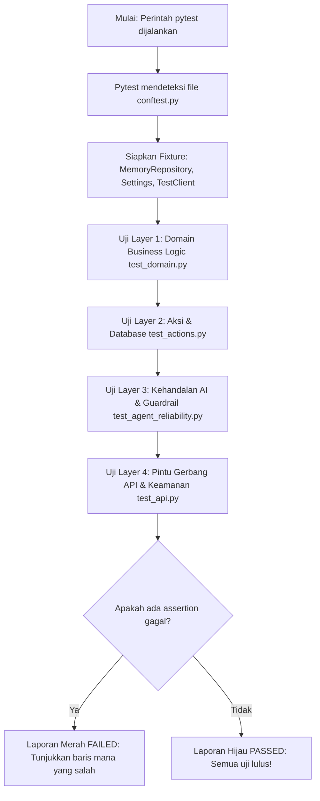

# Panduan Memahami Pengujian (Testing) di HR-Agent

Dokumen ini ditulis dengan bahasa yang mudah dipahami bagi siapa pun (termasuk yang belum familiar dengan arsitektur backend Python) untuk mengerti:
1. **Mengapa aplikasi ini perlu diuji?**
2. **Apa yang terjadi di balik layar saat pengujian berjalan?**
3. **Peta file pengujian dan skenario apa saja yang diuji.**
4. **Analogi sederhana (seperti uji kelaikan mobil atau inspeksi restoran).**

---

## 1. Analogi Sederhana: Inspeksi Restoran & Kasir

Bayangkan aplikasi HR-Agent ini seperti sebuah restoran yang mempekerjakan asisten pintar untuk melayani cuti karyawan:
- **Pelanggan** (Karyawan) memesan sesuatu lewat kasir (API).
- **Kasir** mengecek kartu identitas (Autentikasi & Otorisasi).
- **Koki/Manajer** (Domain Logic) mengecek buku resep dan stok bahan (Validasi saldo cuti & tanggal).
- **Buku Catatan Transaksi** (Database/Repository) mencatat pesanan agar tidak dobel tagih (Idempotency).
- **Asisten Konsultan** (AI Agent) harus menjawab sopan, jujur, dan tidak boleh mengarang dokumen palsu (Hallucination & Reliability Guardrail).

**Alat Penguji (`pytest`)** adalah petugas inspeksi kualitas. Sebelum restoran dibuka untuk umum, petugas ini mengirimkan berbagai skenario: ada yang pura-pura lupa bawa ID, ada yang minta jatah cuti padahal kuotanya habis, ada yang mencoba menipu AI dengan dokumen palsu, hingga simulasi internet mati di tengah transaksi.

Jika semua skenario lolos, sistem dinyatakan **layak dan aman** untuk digunakan!

---

## 2. Tools yang Digunakan: Apa itu Pytest & TestClient?

| Nama Alat | Peran Utama | Padanan di Dunia PHP / JS |
| :--- | :--- | :--- |
| **`pytest`** | Mesin/Juri yang mencari semua file bertanda `test_*.py`, menjalankannya satu per satu, dan memberi laporan hijau (LULUS) atau merah (GAGAL). | `PHPUnit` (PHP), `Jest` (JavaScript) |
| **`TestClient`** (FastAPI) | Mesin simulasi HTTP request. Kita bisa mengirim request `GET` / `POST` tanpa perlu menyalakan server di terminal lain atau port `localhost:8000`. Cepat dan hemat memori. | `Supertest` (Node.js), Laravel `$this->postJson()` |
| **`pytest.fixture`** | "Penyedia panggung". Menyiapkan database bersih, data dummy, dan token tes sebelum setiap fungsi test dimulai, lalu merapikannya kembali setelah selesai. | `beforeEach()` / `setUp()` |

---

## 3. Alur Eksekusi Saat Perintah `pytest` Dijalankan

Ketika Anda mengetik `pytest` di terminal, berikut alur perjalanannya:



1. **Tahap Persiapan (Fixtures di `conftest.py`):**
   - Pytest membaca file penyedia setting dan data dummy.
   - Database dibuat dalam memori RAM (`MemoryRepository`), sehingga pengujian tidak mengotori database PostgreSQL asli.
   - Provider AI diatur ke mode simulasi (`DeterministicProvider` / `fake`), sehingga pengujian berjalan instan tanpa biaya token API OpenAI.

2. **Tahap Eksekusi File demi File:**
   - Pytest mengeksekusi setiap fungsi yang berawalan `test_*`.
   - Menggunakan perintah `assert`. Jika kondisi benar (`True`), lanjut. Jika salah (`False`), proses berhenti dan memunculkan laporan kesalahan.

3. **Tahap Pelaporan:**
   - Menampilkan ringkasan: berapa detik waktu uji dan berapa banyak skenario yang lolos.

---

## 4. Peta Pengujian di HR-Agent: Apa Saja yang Diuji?

Pengujian di proyek ini dibagi menjadi 4 layer utama (dari yang paling dalam ke pintu gerbang luar):

```
PHASE2/HR-Agent/tests/
│
├── conftest.py                <- Panggung Utama (Fixtures & Dependency Injection)
├── test_domain.py             <- Layer 1: Aturan Bisnis Murni (Kalkulasi Hari & Saldo)
├── test_actions.py            <- Layer 2: Validasi Proposal Cuti & Penyimpanan Data
├── test_agent_reliability.py  <- Layer 3: Kehandalan AI, Guardrail, & Redaksi Rahasia
└── test_api.py                <- Layer 4: Endpoint HTTP, Login Token, & Otorisasi Hak Akses
```

---

### Layer 1: Aturan Bisnis Murni (`test_domain.py`)
Menguji aturan dasar tanpa memedulikan internet atau AI:
- **Pengecekan Hari Kerja:** Memastikan bahwa hari Sabtu dan Minggu tidak dihitung memotong kuota cuti (Jumat ke Senin hanya dihitung 2 hari kerja).
- **Blokir Tanggal Tidak Logis:** Pengajuan cuti di masa lalu atau tanggal selesai yang mendahului tanggal mulai harus langsung ditolak.
- **Pencegahan Over-quota & Tumpang Tindih:** Karyawan dengan saldo 2 hari tidak boleh mengajukan cuti 5 hari, dan tidak boleh mengajukan cuti di tanggal yang sudah pernah diajukan sebelumnya.
- **Tipe Cuti Tidak Valid:** Menolak jenis cuti fiktif (misal: "cuti belajar" jika belum didukung kontrak).

---

### Layer 2: Aksi & Integritas Data (`test_actions.py`)
Menguji alur setelah proposal cuti dibuat dan siap dikonfirmasi:
- **Idempotensi (Anti Double Click):** Jika seorang karyawan tidak sengaja menekan tombol "Konfirmasi Cuti" dua kali dengan cepat, sistem hanya membuat 1 tiket cuti, bukan 2 tiket berbeda.
- **Pencegahan Pembajakan Proposal:** Karyawan A tidak boleh mengonfirmasi proposal milik Karyawan B.
- **Masa Kedaluwarsa Proposal:** Proposal cuti memiliki batas waktu validitas (TTL). Proposal yang sudah kadaluwarsa wajib ditolak jika baru dikonfirmasi.

---

### Layer 3: Kehandalan AI & Guardrail (`test_agent_reliability.py`)
Menguji asisten cerdas agar tetap aman dan tidak membahayakan sistem:
- **Simulasi Gangguan Provider (Fault Tolerance):** Jika server AI OpenAI mengalami *timeout* atau *down*, asisten tidak boleh crash. Asisten harus mundur teratur (*abstain* secara sopan) tanpa meninggalkan data sampah di database.
- **Redaksi Rahasia (Security Redaction):** Jika terjadi error, data sensitif (seperti API token/kunci rahasia) tidak boleh bocor ke catatan riwayat (*trace log*).
- **Anti-Halusinasi Dokumen:** Jika AI mengarang nomor dokumen kebijakan yang sebenarnya tidak ada (misal dokumen palsu `HR-FAKE-999`), sistem guardrail mendeteksi dan membatalkan jawaban tersebut.
- **Kestabilan Dokumen:** Potongan dokumen kebijakan (*policy chunks*) harus konsisten dan memiliki metadata versi serta tanggal berlaku yang valid.

---

### Layer 4: Pintu Gerbang HTTP & Keamanan API (`test_api.py`)
Menguji endpoint FastAPI yang diakses oleh frontend/pengguna:
- **Pengecekan Healthcheck:** Endpoint `/healthz` harus selalu menjawab `{"status": "ok"}`.
- **Autentikasi Token (401 Unauthorized):** Siapa pun yang mencoba chat tanpa header Bearer Token yang sah akan langsung ditolak dengan kode status HTTP `401`.
- **Hak Akses Admin / RBAC (403 Forbidden):** Karyawan biasa yang mencoba membuka halaman pemantauan `/api/v1/monitoring/summary` akan mendapat pesan `403 Forbidden`. Hanya akun berlabel `admin` yang diizinkan.
- **Perlindungan Privasi Antar Pegawai:** Karyawan bernama Bima tidak boleh membaca riwayat chat (*trace log*) milik Alya. Sistem mengunci data per `employee_id`.

---

## 5. Mengapa Pengujian Menggunakan Mock / In-Memory?

Mungkin Anda bertanya: *“Kenapa tidak dites langsung ke database Postgres atau OpenAI yang asli?”*

1. **Kecepatan Tinggi:** Seluruh pengujian (puluhan skenario) selesai dalam waktu **kurang dari 2 detik**.
2. **Tanpa Biaya (Zero Cost):** Tidak menghabiskan saldo kredit API LLM/OpenAI.
3. **Deterministik (Hasil Konsisten):** Pengujian tidak pernah gagal hanya karena internet pengguna sedang lambat atau server pihak ketiga sedang down.
4. **Isolasi Penuh:** Menguji kesalahan logika program murni, bukan masalah koneksi jaringan.

---

## 6. Cara Menjalankan Pengujian Sendiri

Buka terminal pada folder proyek `PHASE2/HR-Agent`:

```bash
# 1. Pastikan environment aktif
cd PHASE2/HR-Agent

# 2. Jalankan semua pengujian
pytest

# 3. Jalankan pengujian dengan rincian nama fungsi
pytest -v

# 4. Hanya ingin menguji keamanan API
pytest tests/test_api.py -v
```

Jika muncul tulisan:
```text
======================= 13 passed in 0.85s =======================
```
Artinya seluruh sistem, aturan bisnis, keamanan hak akses, dan guardrail AI Anda bekerja 100% sempurna!
