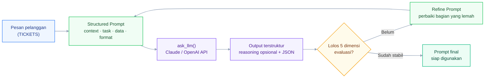

# Week 05 - Day 02: Prompt Technique and Optimization

<!-- markdownlint-disable MD013 -->


[](https://www.python.org/)

Selamat datang di **Praktikum Hands-on Phase 2 Week 5 Day 2** untuk **Applied AI Engineer Bootcamp**.

Tanpa optimasi, prompt yang ditulis asal-asalan sering menimbulkan tiga masalah: **halusinasi** (model mengarang jawaban yang terdengar meyakinkan padahal tidak akurat), **inisiatif terbuang** (model menebak-nebak maksud pengguna karena instruksi tidak terstruktur), dan **token habis** (instruksi bertele-tele memboroskan token tanpa membuat hasil lebih baik). Dalam praktikum ini, Anda akan menulis dan menguji prompt secara terprogram lewat Claude API atau OpenAI API, mengevaluasinya secara sistematis, lalu mengoptimasinya lewat beberapa iterasi sampai stabil.

Notebook utama: [`P2W1D2 - Prompt Technique and Optimization.ipynb`](P2W1D2%20-%20Prompt%20Technique%20and%20Optimization.ipynb)

---

## Tujuan Pembelajaran

Setelah menyelesaikan praktikum hands-on ini, Anda akan mampu:

1. **Menerapkan Structured Prompting:** Memisahkan role/context, instruction/task, data input, dan output format secara eksplisit agar hasil LLM lebih terarah.
1. **Menerapkan Chain-of-Thought Reasoning:** Mendorong model bernalar secara bertahap untuk tugas yang butuh penalaran multi-langkah, seperti mendeteksi sarkasme.
1. **Menerapkan Few-shot Prompting:** Menyertakan contoh input-output yang relevan dan konsisten formatnya di dalam prompt.
1. **Mengevaluasi dan Mengoptimasi Prompt:** Menilai kualitas output lewat 5 dimensi evaluasi, dan melakukan iterasi sampai hasilnya stabil dan konsisten.

---

## Gambaran Sistem



Notebook mengubah satu pesan pelanggan menjadi data terstruktur lewat `ask_llm()`, dievaluasi lewat 5 dimensi (**Konsep 4**), lalu direvisi berulang mengikuti siklus Draft-Uji-Evaluasi-Refine (**Konsep 5**) sampai hasilnya stabil.

---

## Tools yang Digunakan

- **Claude API atau OpenAI API**: cukup pilih salah satu, dipakai lewat SDK resmi (`anthropic` atau `openai`) di dalam notebook.
- **Python 3.10 atau lebih baru**: diperlukan oleh versi package yang digunakan dalam notebook.
- **Jupyter Notebook**: JupyterLab, Jupyter Notebook, atau VS Code dengan ekstensi Jupyter, untuk menjalankan file `.ipynb`.

> **CATATAN:** Anggaran API yang dibutuhkan kecil (di bawah USD 1 untuk seluruh notebook), karena model default yang dipakai adalah varian murah & cepat dari tiap provider.

---

## Persiapan Environment

### Langkah 1: Siapkan API Key

Buat API key dari salah satu provider berikut:

- **Claude (Anthropic API)**: [console.anthropic.com](https://console.anthropic.com/).
- **ChatGPT (OpenAI API)**: [platform.openai.com](https://platform.openai.com/).

### Langkah 2: Buat File `.env`

Salin `.env.example` menjadi `.env` di folder hands-on yang sama.

macOS atau Linux:

```bash
cp .env.example .env
```

Windows PowerShell:

```powershell
Copy-Item .env.example .env
```

Kemudian isi `PROVIDER` dengan `claude` atau `openai`, lalu isi API key untuk provider yang dipilih. API key provider lain boleh dibiarkan kosong.

Contoh menggunakan Claude:

```text
PROVIDER=claude
ANTHROPIC_API_KEY=isi-api-key-anda
OPENAI_API_KEY=
```

> File `.env` sudah tercantum di `.gitignore`. Jangan mengunggah atau membagikan file tersebut.

### Langkah 3: Buka Notebook dan Pasang Dependency

Buka `P2W1D2 - Prompt Technique and Optimization.ipynb` dengan Jupyter, lalu jalankan sel pertama:

```text
%pip install -q anthropic openai python-dotenv
```

### Langkah 4: Jalankan Sel Setup

Pastikan notebook dibuka dari folder hands-on agar `load_dotenv(dotenv_path=".env")` dapat menemukan file `.env`, lalu jalankan cell konfigurasi pada **Bagian 2. Kredensial lewat file `.env`**.

**Hasil yang Diharapkan:** sel mencetak `Setup selesai. Provider aktif: ... (...)` tanpa error.

> **Catatan Keamanan:** Jangan menuliskan API key langsung di sel notebook. Simpan kredensial hanya di `.env`, jangan di `.env.example` atau file `.ipynb`.

---

## Layout Direktori Praktikum

```text
week_5_day_2_prompt_technique_and_optimization/
├── .env.example                                      # Template konfigurasi, aman di-commit
├── .gitignore                                        # Mencegah .env ikut ter-commit
├── README.md                                          # Dokumentasi lab hands-on ini
└── P2W1D2 - Prompt Technique and Optimization.ipynb   # Versi student, dikerjakan di sini
```

---

## Konsep Guided Hands-on

Bagian ini memberikan penjelasan mendalam tentang enam konsep utama yang dipraktikkan dalam sesi ini.

---

### Konsep 1: Structured Prompting

Pisahkan prompt jadi 4 komponen eksplisit: **Context & Persona** (peran model), **Instruction/Task** (yang harus dikerjakan), **Data Input** (dipisah dengan delimiter seperti `<data>...</data>`), dan **Output Format** (bentuk keluaran yang diinginkan).

---

### Konsep 2: Chain-of-Thought (CoT)

Minta model menjabarkan penalaran sebelum jawaban akhir. **Zero-shot CoT** cukup satu frasa pemicu ("mari kita pikirkan langkah demi langkah"); **manual/few-shot CoT** memberi contoh alur penalaran lengkap, lebih terarah untuk kasus spesifik.

---

### Konsep 3: Few-shot Prompting

Sertakan 2-5 contoh pasangan input-output sebelum query baru. Pilih contoh yang mewakili variasi kasus nyata, jaga formatnya konsisten, dan seimbangkan antar kategori.

---

### Konsep 4: Dimensi Evaluasi Kualitas Output

Prompt bersifat non-deterministik, jadi perlu dievaluasi lewat 5 dimensi:

| Dimensi | Yang Dicek |
| --- | --- |
| Konsistensi | Hasil sama/serupa saat dijalankan berulang pada input yang mirip |
| Kesesuaian Format | Output mengikuti struktur yang diminta (JSON valid, field lengkap) |
| Akurasi | Jawaban sesuai fakta atau ground truth yang benar |
| Relevansi | Jawaban langsung menjawab, tanpa keluar topik |
| Panjang Jawaban | Sesuai instruksi format yang diminta |

---

### Konsep 5: Optimasi Prompt secara Iteratif

Siklus **Draft → Uji → Evaluasi → Refine**, diulang sampai output stabil untuk berbagai variasi input. Tanda sudah stabil: format konsisten meski dijalankan berulang, variasi hasil hanya pada bagian yang memang wajar berubah, dan prompt tidak perlu penjelasan tambahan setiap dipakai ulang.

> **Catatan Efisiensi Biaya:** prompt yang ringkas dan langsung ke inti menghasilkan token lebih sedikit dan biaya API lebih rendah, tanpa mengorbankan kualitas jawaban. Hindari kalimat pembuka yang tidak perlu (mis. "Tolong dengan sangat teliti dan detail..."), langsung ke instruksi inti, dan batasi panjang output secara eksplisit (mis. "maksimal 3 kalimat") untuk mengontrol token keluaran.

---

### Konsep 6: Self-Check Prompting

Setelah model memberi jawaban awal, minta model mereview dan memperbaiki jawabannya sendiri sebelum dianggap final, lewat 4 langkah: **1) Jawaban Awal** (model menjawab seperti biasa) → **2) Cari Kelemahan** (minta model mengidentifikasi kekurangan dari jawabannya sendiri) → **3) Revisi** (model menulis ulang jawaban yang memperbaiki kelemahan tersebut) → **4) Kesimpulan Akhir** (jawaban final yang sudah diperbaiki). Teknik ini paling pas dipakai pada tahap **Refine** di siklus Draft-Uji-Evaluasi-Refine (Konsep 5). Contoh frasa pemicu: *"Review jawabanmu di atas. Identifikasi 3 kelemahan (kurang lengkap? tidak akurat? melewatkan syarat?). Tulis ulang versi yang lebih baik."*

---

## Hands-On-Lab

Dikerjakan **individu**.

### Studi Kasus

Anda berperan sebagai tim customer service **Northstar Market**, sebuah platform e-commerce fiktif, yang mengubah pesan pelanggan menjadi data terstruktur. Enam tiket berikut dipakai untuk menguji prompt sepanjang praktikum:

| ID | Pesan Pelanggan |
| --- | --- |
| T1 | Paket saya seharusnya sampai 3 hari lalu tapi status masih 'dalam pengiriman'. Saya sudah coba hubungi kurir tapi tidak ada respons. Tolong bantu cek. |
| T2 | Blender yang saya beli minggu lalu retak di bagian wadah kaca padahal baru dipakai dua kali. |
| T3 | Saya sudah mengajukan refund sejak tanggal 2, tapi sampai sekarang dana belum masuk ke rekening. Ini sudah 12 hari kerja. |
| T4 | Apakah promo gratis ongkir masih berlaku untuk pembelian di atas Rp150.000 minggu ini? |
| T5 | Wah, hebat sekali, paket saya dikirim ke alamat yang salah dan sekarang saya harus repot-repot mengurusnya sendiri. Terima kasih banyak, Northstar Market. |
| T6 | Kualitas kemasan rapi, barang sampai lebih cepat dari estimasi, dan sesuai deskripsi. Akan belanja lagi di sini! |

Skema output yang diminta untuk setiap tiket:

```json
{
  "kategori": "pengiriman | produk_cacat | pembayaran_refund | pertanyaan_umum | pujian",
  "sentimen": "positif | netral | negatif",
  "prioritas": "rendah | sedang | tinggi",
  "ringkasan": "ringkasan inti pesan, maksimal 2 kalimat",
  "tindakan_disarankan": "satu tindakan konkret untuk agent"
}
```

> Perhatikan **T5**: kata-katanya terdengar positif, padahal isinya sindiran atas kesalahan pengiriman, dipakai untuk menguji apakah prompt Anda bisa menangani sarkasme.

### Requirements

- `STRUCTURED_PROMPT` (Bagian 3) memiliki 4 komponen structured prompting (Konsep 1) dan diuji pada tiket T1.
- `REASONING_PROMPT` (Bagian 4) menambahkan instruksi chain-of-thought (Konsep 2) dan diuji khusus pada tiket sarkastik T5.
- `FEWSHOT_PROMPT` (Bagian 5) menambahkan minimal 2 contoh few-shot (Konsep 3) dan diuji pada T5 dan T6.
- `FINAL_PROMPT` (Bagian 6) diuji pada minimal 3 tiket berbeda, masing-masing dijalankan ulang 2-3 kali untuk mengecek Konsistensi, lalu direvisi mengikuti siklus Draft-Uji-Evaluasi-Refine (Konsep 5) sampai kelima dimensi evaluasi (Konsep 4) terpenuhi.
- Tabel evaluasi dan log iterasi pada sel markdown terakhir notebook sudah diisi sebagai dokumentasi proses.

### Langkah Pengerjaan

#### 3. Structured Prompting

Lengkapi `STRUCTURED_PROMPT` dengan 4 komponen pada Konsep 1, lalu uji dengan tiket T1.

#### 4. Chain-of-Thought

Salin `STRUCTURED_PROMPT` ke `REASONING_PROMPT`, tambahkan instruksi penalaran bertahap, lalu uji khusus pada tiket T5.

#### 5. Few-shot Prompting

Salin `REASONING_PROMPT` ke `FEWSHOT_PROMPT`, tambahkan 2-5 contoh, lalu uji pada T5 dan T6.

#### 6. Evaluasi & Optimasi hingga Stabil

Salin `FEWSHOT_PROMPT` ke `FINAL_PROMPT`, uji pada minimal 3 tiket, jalankan ulang sel yang sama 2-3 kali per tiket untuk mengecek Konsistensi, lalu revisi mengikuti siklus Draft-Uji-Evaluasi-Refine sampai memenuhi kriteria stabil. Isi tabel evaluasi dan log iterasi di sel markdown terakhir.

> **Opsional:** pada tahap Refine, Anda boleh mencoba **Self-Check Prompting** (Konsep 6) -- minta model mereview dan mengidentifikasi kelemahan dari keluarannya sendiri sebelum Anda merevisi `FINAL_PROMPT` secara manual. Teknik ini tidak wajib dan tidak memengaruhi penilaian, tapi bisa membantu menemukan kelemahan prompt lebih cepat.

### Checklist Implementasi

- [ ] `STRUCTURED_PROMPT` memiliki role/context, task, data, dan format yang jelas, sudah diuji pada T1.
- [ ] `REASONING_PROMPT` menambahkan instruksi penalaran bertahap, sudah diuji pada T5.
- [ ] `FEWSHOT_PROMPT` menambahkan minimal 2 contoh, sudah diuji pada T5 dan T6.
- [ ] `FINAL_PROMPT` sudah diuji pada minimal 3 tiket, masing-masing diulang 2-3 kali.
- [ ] Tabel evaluasi 5 dimensi dan log iterasi sudah diisi di sel markdown terakhir.
- [ ] Tidak ada API key tertulis permanen di file notebook.

### Cara Menguji

1. Jalankan seluruh notebook dari atas ke bawah tanpa error.
1. Untuk tiket T5, pastikan `sentimen` akhir konsisten `negatif` pada seluruh pengulangan, sebagai bukti prompt sudah menangani sarkasme.
1. Bandingkan output `FINAL_PROMPT` dengan contoh hasil pada bagian "Verifikasi & Pemeriksaan Solusi" di bawah. Prompt Anda tidak harus identik selama memenuhi kontrak output dan lolos kelima dimensi evaluasi.

### Kriteria Selesai

1. Keempat bagian (Structured Prompting, CoT, Few-shot, Evaluasi & Optimasi) sudah dikerjakan dan menghasilkan JSON valid.
1. `FINAL_PROMPT` memenuhi kelima dimensi evaluasi pada Konsep 4 secara konsisten pada minimal 3 tiket.
1. Tabel evaluasi dan log iterasi terisi, termasuk kesimpulan pada percobaan keberapa prompt dinyatakan stabil.

---

## Verifikasi & Pemeriksaan Solusi

Untuk memverifikasi implementasi Anda, cek output `FINAL_PROMPT` pada tiket T1, contoh hasil yang diharapkan:

```json
{
  "kategori": "pengiriman",
  "sentimen": "negatif",
  "prioritas": "tinggi",
  "ringkasan": "Paket terlambat dari estimasi dan pelanggan tidak mendapat respons dari kurir.",
  "tindakan_disarankan": "Lacak nomor resi dan hubungi kurir untuk update status pengiriman."
}
```

> Nilai persis pada field `ringkasan` dan `tindakan_disarankan` bisa berbeda kata-kata karena LLM non-deterministik, yang penting struktur field dan makna intinya sama.

---

## Panduan Pemecahan Masalah

| Masalah | Kemungkinan penyebab | Solusi |
| --- | --- | --- |
| `AuthenticationError` / `401` | API key salah, kedaluwarsa, atau kosong | Periksa `PROVIDER` sesuai key yang dimasukkan, jalankan ulang sel Setup |
| Rate limit / kuota habis | Terlalu banyak request, atau saldo API habis | Tunggu sebentar, atau periksa saldo akun API |
| `ModuleNotFoundError` | Sel `%pip install` belum dijalankan atau kernel salah | Jalankan ulang sel instalasi, restart kernel |
| Output bukan JSON valid | Instruksi `[FORMAT]` kurang tegas | Perjelas instruksi, mis. "Balas HANYA dengan satu objek JSON" |
| T5 terklasifikasi `positif` | Prompt belum menangani sarkasme | Tambahkan instruksi CoT (Konsep 2) atau contoh few-shot (Konsep 3) |

---

## Referensi

- [Anthropic: Prompt Engineering Overview](https://docs.claude.com/en/docs/build-with-claude/prompt-engineering/overview)
- [Anthropic: Prompting Best Practices (Chain of Thought)](https://docs.claude.com/en/docs/build-with-claude/prompt-engineering/chain-of-thought)
- [Anthropic: Multishot Prompting](https://docs.claude.com/en/docs/build-with-claude/prompt-engineering/multishot-prompting)
- [OpenAI: Prompt Engineering Guide](https://platform.openai.com/docs/guides/prompt-engineering)
- [Wei et al. (2022): Chain-of-Thought Prompting](https://arxiv.org/abs/2201.11903)
- [Brown et al. (2020): Language Models are Few-Shot Learners](https://arxiv.org/abs/2005.14165)
- [promptingguide.ai](https://www.promptingguide.ai/)
- [OpenAI Cookbook](https://cookbook.openai.com/): contoh praktis prompting.
- Sesi lanjutan: Sesi 3, Data Infrastructure for AI.

Selamat! Anda telah menyelesaikan **P2W1D2: Prompt Technique and Optimization**!
