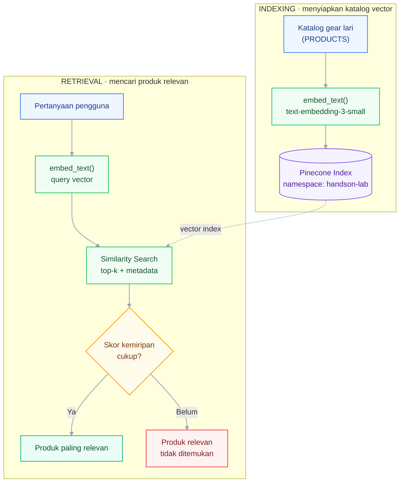

# Week 05 - Day 03: Data Infrastructure for AI

<!-- markdownlint-disable MD013 -->


[](https://www.python.org/)

Selamat datang di **Praktikum Hands-on Phase 2 Week 5 Day 3** untuk **Applied AI Engineer Bootcamp**.

LLM tidak mengingat data privat atau data yang lebih baru dari waktu training-nya. Supaya aplikasi AI bisa menjawab berdasarkan data internal (katalog produk, basis pengetahuan support, dokumen perusahaan), teks itu perlu diubah jadi **vector (embedding)** dan disimpan di **vector database**, supaya bisa dicari berdasarkan **kemiripan makna**, bukan sekadar kecocokan kata. Dalam praktikum ini, Anda akan setup vector database dengan **Pinecone**, mengubah katalog gear lari elite fiktif jadi vector lewat embedding model, menyimpannya, melakukan pencarian kemiripan (similarity search), lalu membungkusnya jadi fungsi pencarian sederhana yang siap dipakai aplikasi.

Notebook utama: [`P2W1D3 - Data Infrastructure for AI.ipynb`](P2W1D3%20-%20Data%20Infrastructure%20for%20AI.ipynb)

---

## Tujuan Pembelajaran

Setelah menyelesaikan praktikum hands-on ini, Anda akan mampu:

1. **Menjelaskan Kebutuhan Vector Database:** Mengenali kapan pencarian semantik lewat vector database diperlukan dibanding pencarian tradisional berbasis kata kunci.
1. **Melakukan Setup & Indexing:** Menyiapkan vector database Pinecone beserta index yang sesuai untuk menyimpan data vektor.
1. **Melakukan Insert & Query Data Vektor:** Menyimpan embedding ke dalam vector database dan melakukan pencarian kemiripan (similarity search) terhadap data tersebut.
1. **Mengintegrasikan ke Aplikasi:** Menghubungkan vector database ke dalam alur aplikasi sederhana, sebagai fondasi untuk kebutuhan seperti RAG.

---

## Gambaran Sistem



Notebook mengubah katalog produk menjadi vector lewat `embed_text()`, menyimpannya ke index Pinecone (**Konsep 2**), lalu pertanyaan pengguna diubah jadi vector yang sama untuk dicari kemiripannya (**Konsep 4**), dan akhirnya dibungkus jadi fungsi `search()` yang dipakai aplikasi (**Konsep 5**). Notebook ini baru sampai tahap retrieval (mengembalikan produk paling relevan) -- menyusun jawaban dalam bahasa alami dari hasil ini (generation, inti dari RAG) dipelajari lengkap di **Sesi 4, RAG & LangChain**.

---

## Tools yang Digunakan

- **OpenAI API**: dipakai untuk membuat embedding lewat model `text-embedding-3-small`.
- **Pinecone** (managed vector database, free tier Starter): butuh akun dan API key dari [app.pinecone.io](https://app.pinecone.io/).
- **Python 3.10 atau lebih baru**: diperlukan oleh versi package yang digunakan dalam notebook.
- **Jupyter Notebook**: JupyterLab, Jupyter Notebook, atau VS Code dengan ekstensi Jupyter, untuk menjalankan file `.ipynb`.

> **CATATAN BIAYA:** Pinecone Starter gratis untuk skala latihan ini (2GB storage). Biaya OpenAI API untuk seluruh notebook (8 produk gear lari + beberapa query embedding) jauh di bawah USD 1.

---

## Persiapan Environment

### Langkah 1: Siapkan Kredensial

- **OpenAI API key** (wajib, untuk embedding): [platform.openai.com](https://platform.openai.com/).
- **Pinecone API key** (wajib, untuk vector database): buat akun Starter di [app.pinecone.io](https://app.pinecone.io/), lalu generate API key.

### Langkah 2: Buat File `.env`

Salin `.env.example` menjadi `.env` di folder hands-on yang sama.

macOS atau Linux:

```bash
cp .env.example .env
```

Windows PowerShell:

```powershell
Copy-Item .env.example .env
```

Kemudian isi kedua API key berikut:

```text
OPENAI_API_KEY=isi-openai-api-key-anda
PINECONE_API_KEY=isi-pinecone-api-key-anda
```

> File `.env` sudah tercantum di `.gitignore`. Jangan mengunggah atau membagikan file tersebut.

### Langkah 3: Buka Notebook dan Pasang Dependency

Buka `P2W1D3 - Data Infrastructure for AI.ipynb` dengan Jupyter, lalu jalankan sel pertama:

```text
%pip install -q openai pinecone python-dotenv
```

### Langkah 4: Jalankan Sel Setup

Pastikan notebook dibuka dari folder hands-on agar `load_dotenv(dotenv_path=".env")` dapat menemukan file `.env`, lalu jalankan cell konfigurasi pada **Bagian 2. Kredensial lewat file `.env`**.

**Hasil yang Diharapkan:** sel mencetak `Setup selesai. Embedding model: text-embedding-3-small` tanpa error.

> **Catatan Keamanan:** Jangan menuliskan API key langsung di sel notebook. Simpan kredensial hanya di `.env`, jangan di `.env.example` atau file `.ipynb`.

---

## Layout Direktori Praktikum

```text
week_5_day_3_data_infrastructure_for_ai/
├── .env.example                                      # Template konfigurasi, aman di-commit
├── .gitignore                                        # Mencegah .env ikut ter-commit
├── README.md                                          # Dokumentasi lab hands-on ini
└── P2W1D3 - Data Infrastructure for AI.ipynb          # Versi student, dikerjakan di sini
```

---

## Konsep Guided Hands-on

Bagian ini memberikan penjelasan mendalam tentang lima konsep utama yang dipraktikkan dalam sesi ini.

---

### Konsep 1: Vector Database dan Embedding

**Embedding** adalah representasi numerik (deretan angka) dari makna suatu teks, dihasilkan oleh embedding model (di sini `text-embedding-3-small` dari OpenAI, 1536 dimensi). **Vector database** menyimpan embedding tersebut dan mencarinya lewat kemiripan makna (semantic search), bukan lewat exact match seperti `WHERE kolom = 'nilai'` pada database biasa. Dua kalimat dengan makna mirip akan menghasilkan vector yang berdekatan meskipun susunan kata dan gaya bahasanya berbeda. Inilah yang membuat pencarian "sepatu buat kejar PB di marathon" dapat menemukan produk yang dideskripsikan sebagai "sepatu racing dengan carbon plate untuk mengejar catatan waktu terbaik".

---

### Konsep 2: Kontrak Index (Setup & Indexing)

Sebelum insert atau query data, tentukan dulu konfigurasi index yang **konsisten dipakai di semua tahap** (setup, insert, query):

| Parameter | Nilai | Keterangan |
| --- | --- | --- |
| `INDEX_NAME` | `aien-elite-runner-gear` | Nama index Pinecone |
| `DIMENSION` | `1536` | Harus sama dengan dimensi output `text-embedding-3-small` |
| `METRIC` | `cosine` | Metric jarak yang dipakai untuk mengukur kemiripan |
| `NAMESPACE` | `handson-lab` | Memisahkan data latihan ini dari data lain di project Pinecone yang sama |

> Kalau dimension yang dibuat saat setup index tidak sama dengan dimensi output embedding model, insert atau query akan gagal (error dimension mismatch).

---

### Konsep 3: Persiapan Data dan Metadata

Setiap produk yang disimpan butuh **metadata** (informasi pendukung di luar vector-nya), minimal: `source` (ID produk), `category` (jenis gear, misalnya `sepatu` atau `jam_gps`), dan teks deskripsinya sendiri (karena hasil pencarian perlu ditampilkan dalam bentuk teks yang bisa dibaca, bukan cuma angka vector). Deskripsi produk pada praktikum ini sudah pendek dan berdiri sendiri (satu produk per entri), jadi tidak perlu di-chunking lagi -- tapi prinsipnya sama seperti dokumen panjang: setiap potongan harus punya satu konteks utama yang jelas.

---

### Konsep 4: Similarity Search, Top-k, dan Metadata Filtering

Query diubah jadi vector dengan model embedding **yang sama** dengan yang dipakai saat insert, lalu dicocokkan lewat metric yang sama (`cosine`). Parameter `top_k` menentukan berapa banyak hasil paling mirip yang dikembalikan. Top-k kecil (1-3) cocok untuk jawaban spesifik, sedangkan top-k lebih besar cocok untuk menampilkan beberapa pilihan produk. **Metadata filtering** membatasi hasil berdasarkan atribut seperti `category`. Mekanisme dan dampak performanya dapat berbeda pada setiap vector database.

---

### Konsep 5: Integrasi ke Aplikasi Sederhana

Alur aplikasi retrieval sederhana: **terima input user** → **ubah jadi embedding** (model sama seperti saat insert) → **query ke vector database** (top-k hasil paling mirip) → **kembalikan hasil** (teks asli + metadata) ke pengguna. Kalau skor kemiripan hasil teratas terlalu rendah, aplikasi sebaiknya menampilkan pesan "tidak ditemukan" daripada memaksakan hasil yang tidak relevan. Tahap ini baru mengembalikan produk paling relevan, belum menyusun jawaban dalam bahasa alami -- menggabungkan hasil retrieval ini dengan LLM (generation) adalah inti dari **RAG (Retrieval-Augmented Generation)**, dipelajari lengkap di **Sesi 4, RAG & LangChain**.

---

## Hands-On-Lab

Dikerjakan **individu**.

### Studi Kasus

Anda membantu **RunVerse**, toko online gear lari elite fiktif, membangun fitur **pencarian produk berbasis makna** di halaman katalog mereka, supaya pelanggan (pelari kompetitif dan penggemar marathon) bisa mengetik pertanyaan pakai bahasa sehari-hari (misalnya "sepatu enteng buat kejar PB marathon") dan tetap menemukan produk yang tepat, walau kata-katanya tidak sama persis dengan deskripsi produk. Delapan produk seri pelari elite berikut dipakai sepanjang praktikum:

| ID | Kategori | Deskripsi Produk |
| --- | --- | --- |
| prod-coros-pace3 | jam_gps | COROS PACE 3, GPS running watch ringan (30 gram) dengan baterai tahan hingga 24 hari mode biasa, akurasi pace dan jarak yang konsisten, favorit pelari kompetitif untuk pantau data latihan harian. |
| prod-garmin-fr965 | jam_gps | Garmin Forerunner 965, GPS watch dengan layar AMOLED terang, fitur training readiness dan running dynamics lengkap, cocok untuk pelari elite yang butuh analisis latihan mendalam. |
| prod-adidas-adizero-pro3 | sepatu | Adidas Adizero Adios Pro 3, sepatu lari racing dengan carbon plate dan midsole Lightstrike Pro, didesain untuk mengejar catatan waktu terbaik di lomba marathon. |
| prod-puma-fastr-elite2 | sepatu | PUMA Fast-R Nitro Elite 2, sepatu racing dengan NITROFOAM Elite dan carbon plate, dirancang aerodinamis untuk pelari elite yang mengejar personal best di jarak jauh. |
| prod-nike-alphafly3 | sepatu | Nike Alphafly 3, sepatu racing dengan ZoomX foam dan carbon plate ganda, salah satu sepatu paling banyak dipakai pelari elite dunia untuk lomba marathon besar. |
| prod-2xu-compression | apparel | 2XU Compression Race Tights, celana kompresi dengan teknologi PWX yang membantu sirkulasi darah dan mengurangi kelelahan otot saat lari jarak jauh. |
| prod-nakedrunning-band | aksesori | Naked Running Band, hydration belt minimalis tanpa bouncing yang muat beberapa gel dan handphone, favorit pelari elite untuk lomba marathon supaya tidak perlu berhenti di water station. |
| prod-theragun-mini | recovery | Theragun Mini, alat pemulihan otot portable dengan percussive therapy, dipakai pelari elite untuk pemulihan otot cepat setelah sesi latihan berat. |

> Nama produk dan merek di atas dipakai sebagai contoh nyata gear yang populer di kalangan pelari elite, semata-mata untuk keperluan latihan pencarian semantik -- tidak ada afiliasi atau endorsement resmi dari merek-merek tersebut.

### Requirements

- **Bagian 3 (Setup & Indexing)**: Index Pinecone berhasil dibuat sesuai Kontrak Index pada **Konsep 2**, dan lolos connection test.
- **Bagian 4 (Insert Data Vektor)**: Seluruh 8 produk `PRODUCTS` berhasil diubah jadi embedding dan disimpan (upsert) lengkap dengan metadata `source`, `category`, dan `text`.
- **Bagian 5 (Query Data Vektor)**: Fungsi `query_similar()` berhasil diuji pada minimal 3 pertanyaan dengan susunan kata yang berbeda dari deskripsi produk. Produk target harus muncul dalam hasil Top-3. Tambahkan satu contoh query dengan metadata filter berdasarkan `category`.
- **Bagian 6 (Integrasi ke Aplikasi)**: Fungsi `search()` berhasil dipakai pada daftar `USER_QUESTIONS` (termasuk satu pertanyaan di luar cakupan 8 produk), dengan penanganan hasil kurang relevan sesuai **Konsep 5**.
- Tabel refleksi pada sel markdown terakhir notebook sudah diisi sebagai dokumentasi proses.

### Langkah Pengerjaan

#### 3. Setup & Indexing Vector Database

Pada **Bagian 3. Setup & Indexing**, buat index Pinecone (dimension, metric sesuai Kontrak Index). Jalankan connection test untuk memastikan index siap dipakai sebelum lanjut ke insert data. Bagian ini belum menggunakan `PRODUCTS`, sehingga `total_vector_count=0` adalah hasil yang benar untuk index baru. Jumlah vector menjadi 8 setelah Bagian 4 selesai.

#### 4. Persiapan & Insert Data Vektor

Untuk tiap produk di `PRODUCTS`, buat embedding-nya lewat `embed_text()`, lalu upsert ke Pinecone beserta metadata `source`, `category`, dan `text`. Pastikan `id` yang dipakai stabil (pakai ID dari `PRODUCTS`, bukan dibuat acak), supaya proses ini aman dijalankan ulang tanpa membuat data ganda (idempoten).

#### 5. Query Data Vektor

Lengkapi `query_similar(query_text, top_k, category=None)`: ubah `query_text` jadi embedding, cari `top_k` produk paling mirip di Pinecone, kembalikan teks + skor + metadata-nya. Uji dengan pertanyaan berparafrasa (lihat contoh di notebook), lalu tambahkan satu uji dengan filter `category`.

#### 6. Integrasi ke Aplikasi Sederhana

Bungkus `query_similar()` jadi fungsi `search(query_text, top_k=3, min_score=0.4)` yang menambahkan pengecekan ambang skor kemiripan. Kalau skor tertinggi di bawah ambang, kembalikan pesan "tidak ditemukan". Nilai `0.4` merupakan baseline dari hasil pengujian dataset ini dan perlu dievaluasi kembali jika model atau data berubah. Uji dengan daftar `USER_QUESTIONS` yang sudah disediakan, termasuk satu pertanyaan di luar topik pencarian produk, lalu isi tabel refleksi di sel markdown terakhir.

### Checklist Implementasi

- [ ] Sel Setup berjalan tanpa error.
- [ ] Index Pinecone berhasil dibuat sesuai Kontrak Index (Konsep 2).
- [ ] Seluruh 8 produk `PRODUCTS` berhasil di-upsert dengan metadata lengkap.
- [ ] `query_similar()` diuji pada minimal 3 pertanyaan berparafrasa + 1 query dengan metadata filter.
- [ ] `search()` menangani hasil kurang relevan (ambang skor) dan diuji pada seluruh `USER_QUESTIONS`.
- [ ] Tabel refleksi sudah diisi di sel markdown terakhir.
- [ ] Tidak ada API key tertulis permanen di file notebook.

### Cara Menguji

1. Jalankan seluruh notebook dari atas ke bawah tanpa error.
1. Pertanyaan dengan susunan kata berbeda harus menemukan produk target dalam hasil Top-3. Top-1 dapat berbeda karena similarity search masih dapat menghasilkan noise.
1. Pertanyaan di luar topik pencarian produk (misalnya soal reset password akun) harus dijawab "tidak ditemukan", bukan memaksakan salah satu dari 8 produk.

### Kriteria Selesai

1. Keempat bagian (Setup & Indexing, Insert, Query, Integrasi) sudah dikerjakan dan berjalan tanpa error.
1. `search()` mengembalikan produk yang benar secara semantik untuk pertanyaan berparafrasa, dan menangani pertanyaan di luar cakupan dengan baik.
1. Tabel refleksi terisi, termasuk catatan singkat tentang pengalaman tuning `min_score`.

---

## Verifikasi & Pemeriksaan Solusi

Untuk memverifikasi implementasi Anda, cek hasil `search("Jam tangan buat pantau data lari harian yang baterainya awet")`. Contoh hasil ilustrasi dari pengujian saat ini:

```text
[1] prod-coros-pace3 (score: 0.571, category: jam_gps)
    "COROS PACE 3, GPS running watch ringan (30 gram) dengan baterai tahan hingga 24 hari mode biasa, ..."
```

> Skor dan urutan dapat berubah jika model, versi model, data, atau konfigurasi index berubah. Dengan konfigurasi yang sama, hasil biasanya konsisten ketika cell dijalankan ulang. Gunakan kemunculan produk target dalam Top-3 sebagai kriteria utama.

---

## Panduan Pemecahan Masalah

| Masalah | Kemungkinan penyebab | Solusi |
| --- | --- | --- |
| `AuthenticationError` (OpenAI/Pinecone) | API key salah, kosong, atau kedaluwarsa | Jalankan ulang sel Setup, masukkan key yang benar |
| Dimension mismatch saat insert/query | Dimension index tidak sama dengan output embedding model | Pastikan `DIMENSION = 1536`, sama seperti Kontrak Index (Konsep 2) |
| Index belum siap (`Ready`/exists) | Index Pinecone masih proses inisialisasi | Tunggu beberapa detik, cek status di Pinecone Console sebelum insert |
| Hasil query tidak masuk akal / produk salah muncul teratas | Model embedding query berbeda dengan yang dipakai saat insert | Pastikan `embed_text()` selalu dipanggil dengan model yang sama |
| Pertanyaan di luar topik tetap menampilkan salah satu produk | Ambang skor (`min_score`) di `search()` belum diset atau terlalu rendah | Naikkan `min_score`, uji ulang dengan pertanyaan tidak relevan |
| `query_kwargs["filter"]` tidak mengembalikan hasil apapun | Nilai `category` yang dicari tidak cocok persis dengan metadata yang tersimpan | Cek ejaan `category` saat insert vs saat query, harus sama persis (case-sensitive) |

---

## Referensi

- [Pinecone: Create an Index](https://docs.pinecone.io/guides/index-data/create-an-index) (official docs).
- [Pinecone: Python SDK](https://github.com/pinecone-io/python-sdk) (GitHub).
- [Pinecone: Metadata Filtering](https://docs.pinecone.io/guides/search/filter-by-metadata) (official docs).
- [OpenAI: Embeddings Guide](https://developers.openai.com/api/docs/guides/embeddings).
- [OpenAI: New Embedding Models](https://openai.com/index/new-embedding-models-and-api-updates/) (text-embedding-3).
- Sesi lanjutan: Sesi 4, RAG & LangChain.

Selamat! Anda telah menyelesaikan **P2W1D3: Data Infrastructure for AI**!
