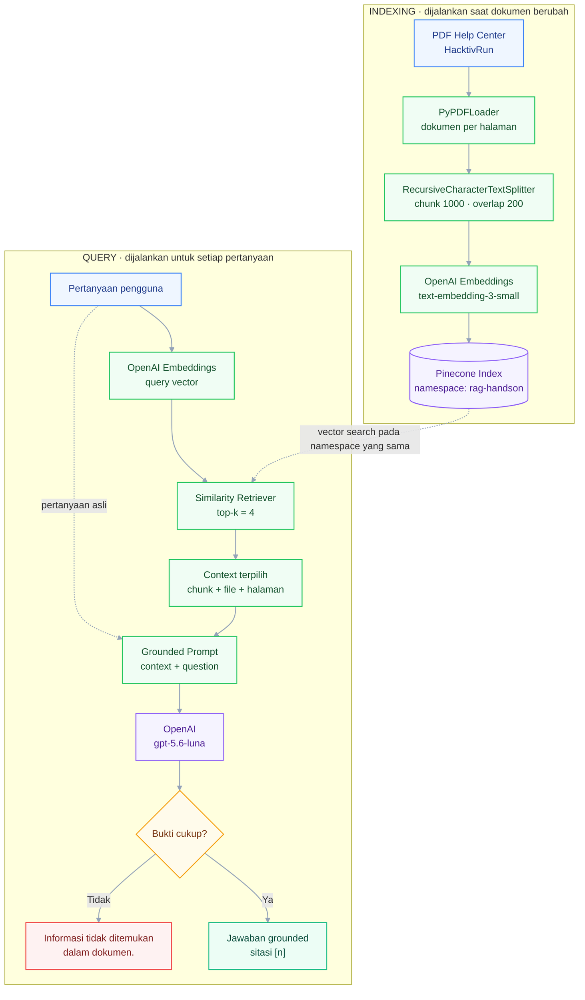

# Week 05 - Day 04: RAG dengan LangChain

<!-- markdownlint-disable MD013 -->


Hands-on ini melanjutkan **Week 05 Day 03 - Data Infrastructure for AI**. Pada sesi sebelumnya Anda menyimpan embedding katalog perlengkapan lari dan melakukan semantic search. Pada sesi ini Anda membangun pipeline **Retrieval-Augmented Generation (RAG)** lengkap untuk HacktivRun: memuat dokumen PDF, memecah dokumen, membuat embedding, menyimpan chunk ke Pinecone, mengambil konteks yang relevan, dan menghasilkan jawaban grounded dengan OpenAI melalui LangChain.

> Notebook peserta: [`P2W1D4 - RAG, LangChain.ipynb`](./P2W1D4%20-%20RAG%2C%20LangChain.ipynb)

## Tujuan Pembelajaran

Setelah menyelesaikan hands-on ini, peserta dapat:

1. Menjelaskan perbedaan tahap **indexing** dan **query** pada RAG.
1. Memuat dokumen PDF dan mempertahankan metadata sumber serta halaman.
1. Membagi dokumen menjadi chunk menggunakan `RecursiveCharacterTextSplitter`.
1. Membuat embedding OpenAI dan menyimpan chunk ke namespace Pinecone yang terisolasi.
1. Menguji hasil retrieval sebelum menghubungkannya ke LLM.
1. Menyusun RAG chain LangChain yang menjawab hanya dari konteks, menyertakan sitasi, dan melakukan fallback saat bukti tidak tersedia.

## Gambaran Sistem



## Tools yang Digunakan

| Tool | Peran |
| --- | --- |
| Python 3.13 | Runtime yang direkomendasikan; Python 3.10–3.13 didukung |
| LangChain | Orkestrasi loader, splitter, retriever, prompt, dan chain |
| OpenAI API | `text-embedding-3-small` untuk embedding dan `gpt-5.6-luna` melalui Responses API untuk jawaban |
| Pinecone | Vector database untuk menyimpan dan mengambil chunk |
| Jupyter Notebook | Lingkungan guided hands-on |

Biaya API OpenAI dan Pinecone mengikuti akun serta konfigurasi sesi sebelumnya. Gunakan namespace khusus lab agar data sesi lain tidak tercampur.

## Persiapan Environment

1. Pastikan index Pinecone dari Day 03 tersedia dengan kontrak berikut:

   - nama index: `aien-elite-runner-gear`
   - dimension: `1536`
   - metric: `cosine`

   Day 03 menyimpan katalog produk pada namespace `handson-lab`. Day 04 memakai ulang index dan model embedding yang sama, tetapi menyimpan chunk PDF HacktivRun pada namespace `rag-handson`. Pemisahan ini mencegah retrieval mencampur katalog produk dengan kebijakan help center.

   Namespace `handson-lab` biasanya berisi 8 vector setelah hands-on Day 03 selesai. Day 04 tidak bergantung pada isi vector tersebut; yang wajib tersedia adalah index dengan dimension dan metric yang sesuai.

   > Namespace `class-demo` pada slide adalah namespace demonstrasi instruktur. Untuk hands-on ini gunakan `rag-handson` seperti pada `.env.example`.

1. Siapkan dan daftarkan kernel Python 3.13 dari root folder lab.

   **macOS/Linux:**

   ```bash
   python3.13 -m venv .venv
   source .venv/bin/activate
   python -m pip install --upgrade pip ipykernel
   python -m ipykernel install --user --name p2w1d4-rag --display-name "Python 3.13 (P2W1D4 RAG)"
   ```

   **Windows PowerShell:**

   ```powershell
   py -3.13 -m venv .venv
   .venv\Scripts\Activate.ps1
   python -m pip install --upgrade pip ipykernel
   python -m ipykernel install --user --name p2w1d4-rag --display-name "Python 3.13 (P2W1D4 RAG)"
   ```

   Setelah notebook dibuka, pilih kernel **Python 3.13 (P2W1D4 RAG)**. Python 3.14 belum kompatibel dengan dependensi `langchain-pinecone` yang digunakan pada hands-on ini.

1. Salin `.env.example` menjadi `.env`.

   ```bash
   cp .env.example .env
   ```

1. Isi `OPENAI_API_KEY` dan `PINECONE_API_KEY`. Pertahankan `OPENAI_MODEL=gpt-5.6-luna`, `OPENAI_EMBEDDING_MODEL=text-embedding-3-small`, dan `PINECONE_NAMESPACE=rag-handson`. Jangan menaruh API key langsung di notebook atau melakukan commit file `.env`.

1. Buka notebook peserta dan pastikan kernel Python 3.13 yang telah didaftarkan sedang aktif sebelum menjalankan cell instalasi.

## Layout Direktori Praktikum

```text
week_5_day_4_rag_langchain/
├── .env.example
├── .gitignore
├── README.md
├── P2W1D4 - RAG, LangChain.ipynb
└── data/
    └── hacktivrun_help_center.pdf
```

## Konsep Guided Hands-on

Lab dibagi menjadi dua jalur yang sengaja diperiksa terpisah:

- **Indexing:** `Load -> Split -> Embed -> Store`
- **Query:** `Retrieve -> Augment -> Generate`

Prinsip penting: jangan langsung menilai LLM. Periksa hasil retrieval terlebih dahulu. Jika chunk yang benar tidak ditemukan, perbaiki loader, chunking, metadata, atau konfigurasi retriever sebelum mengubah prompt.

## Hands-On Lab

### Studi Kasus

HacktivRun memiliki PDF help center berisi kebijakan pengiriman, retur, refund, garansi, dan program membership. Tim support ingin membuat asisten yang:

- menjawab pertanyaan berdasarkan dokumen tersebut;
- menampilkan file sumber dan nomor halaman dari chunk yang dipakai;
- tidak mengarang ketika informasi tidak tersedia.

Dokumen pada folder `data/` adalah data fiktif khusus latihan.

### Urutan Pengerjaan

#### 1. Setup dan validasi environment

Instal paket, muat `.env`, lalu validasi bahwa index Pinecone memiliki dimension `1536` dan metric `cosine`.

#### 2. Load dokumen

Gunakan `PyPDFLoader`. Periksa jumlah halaman, contoh isi, serta metadata `source` dan `page`.

#### 3. Chunk dokumen

Gunakan `RecursiveCharacterTextSplitter` dengan baseline:

```python
chunk_size = 1000
chunk_overlap = 200
```

Tambahkan metadata `document_id`, `page_number`, dan `chunk_index`. Metadata ini akan dipakai untuk sitasi dan debugging.

#### 4. Embed dan store

Gunakan `OpenAIEmbeddings(model="text-embedding-3-small")`, `PineconeVectorStore`, dan namespace `rag-handson`. Gunakan ID deterministik agar rerun tidak membuat duplikasi untuk chunk yang sama.

#### 5. Inspect retrieval

Buat retriever dengan `k=4`, lalu uji pertanyaan tentang retur. Cetak isi chunk beserta halaman. Jangan lanjut ke generation sampai bukti yang relevan terlihat.

#### 6. Build grounded RAG chain

Prompt wajib:

- menjawab hanya dari konteks;
- memperlakukan isi dokumen sebagai data, bukan instruksi;
- menyertakan sitasi `[n]` yang sesuai dengan label chunk;
- mengembalikan kalimat persis **"Informasi tidak ditemukan dalam dokumen."** bila konteks tidak cukup.

#### 7. Uji positive dan negative cases

Gunakan minimal tiga pertanyaan yang jawabannya tersedia dan satu pertanyaan di luar dokumen. Verifikasi jawaban, sitasi, dan fallback.

## Checklist Pengerjaan

- [ ] API key dibaca dari `.env`, bukan ditulis di notebook.
- [ ] Dokumen PDF berhasil dimuat per halaman.
- [ ] Chunk memiliki overlap dan metadata sumber.
- [ ] Embedding model konsisten dengan dimension index Pinecone.
- [ ] Data disimpan di namespace `rag-handson`.
- [ ] Hasil retrieval diperiksa sebelum generation.
- [ ] Prompt membatasi jawaban pada konteks.
- [ ] Jawaban in-scope memiliki sitasi.
- [ ] Pertanyaan out-of-scope menghasilkan fallback yang benar.

## Kriteria Selesai

Hands-on dinyatakan selesai jika:

1. pipeline dapat dijalankan dari PDF sampai jawaban akhir;
1. pertanyaan kebijakan HacktivRun menghasilkan jawaban yang didukung chunk hasil retrieval;
1. jawaban memiliki sitasi `[n]` dan daftar sumber menampilkan nomor halaman yang sesuai;
1. pertanyaan di luar cakupan tidak dijawab dengan halusinasi;
1. peserta dapat menjelaskan bagian pipeline mana yang dijalankan saat indexing dan mana yang dijalankan per query.

## Troubleshooting

| Gejala | Penyebab umum | Perbaikan |
| --- | --- | --- |
| Kernel `Python 3.13 (P2W1D4 RAG)` tidak ditemukan | Kernel belum didaftarkan pada Jupyter | Jalankan perintah setup kernel pada bagian Persiapan Environment |
| `No matching distribution found for simsimd` | Notebook berjalan dengan Python 3.14 | Ganti ke kernel Python 3.13, restart kernel, lalu jalankan ulang cell instalasi |
| `OPENAI_API_KEY belum diisi` | `.env` belum dibuat/diisi | Salin `.env.example`, lalu isi key |
| Index tidak ditemukan | Day 03 belum dijalankan atau nama index berbeda | Buat/cek index di Pinecone dan samakan `PINECONE_INDEX` |
| Dimension mismatch | Embedding model berbeda dari index | Gunakan `text-embedding-3-small` dan index dimension `1536` |
| Retrieval kosong/tidak relevan | Namespace salah atau ingestion belum selesai | Cek namespace, metadata, dan tunggu konsistensi index |
| PDF tidak ditemukan | Notebook dibuka dari direktori lain | Jalankan Jupyter dari folder lab |
| Import error setelah instalasi | Kernel masih memakai package lama | Restart kernel, lalu jalankan notebook dari awal |
| Warning `langchain-community is being sunset` | Peringatan upstream dari paket loader | Tidak memblokir lab; `PyPDFLoader` masih memakai import resmi ini pada versi yang diuji |
| Jawaban tanpa sitasi | Format konteks/prompt tidak sesuai | Pastikan tiap chunk dilabeli `[1]`, `[2]`, dan seterusnya |
| LLM mengarang | Prompt tidak membatasi sumber atau retrieval buruk | Perketat grounding dan inspeksi kembali chunk hasil retrieval |

## Referensi

- [LangChain: Learn - Semantic Search dan RAG](https://docs.langchain.com/oss/python/learn)
- [LangChain: PyPDFLoader](https://docs.langchain.com/oss/python/integrations/document_loaders/pypdfloader)
- [LangChain: RecursiveCharacterTextSplitter](https://docs.langchain.com/oss/python/integrations/splitters/recursive_text_splitter)
- [LangChain: Pinecone vector store](https://docs.langchain.com/oss/python/integrations/vectorstores/pinecone)
- [OpenAI: Embeddings](https://developers.openai.com/api/docs/guides/embeddings)
- [OpenAI: GPT-5.6 Luna](https://developers.openai.com/api/docs/models/gpt-5.6-luna)

---

Selamat! Anda telah membangun pipeline RAG end-to-end yang dapat ditelusuri dari sumber hingga jawaban.
