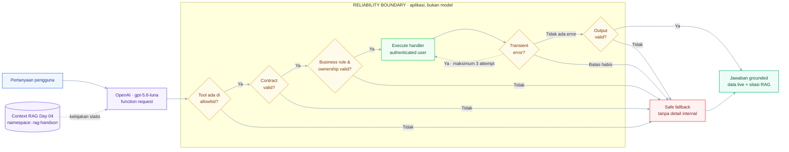

# Week 05 - Day 05: Reliability Layer - Function Calling & Validation

<!-- markdownlint-disable MD013 -->


Hands-on ini melanjutkan **Week 05 Day 04 - RAG dengan LangChain**. Retriever Day 04 dipakai kembali untuk kebijakan statis HacktivRun, sedangkan status pesanan yang dinamis diperoleh melalui OpenAI function calling. Sebelum tool dijalankan, aplikasi memvalidasi contract, allowlist, business rule, dan ownership; kegagalan transient mendapat retry terbatas, sementara kegagalan permanen menghasilkan fallback yang aman.

> Notebook peserta: [`P2W1D5 - Reliability Layer, Function Calling & Validation.ipynb`](./P2W1D5%20-%20Reliability%20Layer%2C%20Function%20Calling%20%26%20Validation.ipynb)

## Tujuan Pembelajaran

Setelah menyelesaikan hands-on ini, peserta dapat:

1. Menjelaskan peran function calling pada RAG, agent, dan automation.
1. Mendefinisikan strict tool schema yang membatasi argumen model.
1. Memvalidasi input dan output tool dengan Pydantic v2.
1. Menegakkan allowlist, business rule, dan ownership sebelum eksekusi.
1. Menerapkan retry terbatas hanya untuk transient error.
1. Menghasilkan fallback aman ketika allowlist, validation, authorization, atau layanan gagal.
1. Menggabungkan context RAG dan data tool menjadi jawaban akhir yang grounded.

## Gambaran Sistem



## Tools yang Digunakan

| Tool | Peran |
| --- | --- |
| Python 3.13 | Runtime notebook yang direkomendasikan |
| OpenAI Responses API | Function calling dan jawaban akhir dengan `gpt-5.6-luna`; output dibatasi agar biaya terkendali |
| Pydantic v2 | Validasi contract argumen dan hasil tool |
| Tenacity | Retry terbatas dengan exponential backoff dan jitter |
| LangChain | Menggunakan kembali retriever RAG Day 04 |
| Pinecone | Mengambil context dari namespace `rag-handson` |
| Jupyter Notebook | Lingkungan guided hands-on |

Biaya OpenAI API dan Pinecone mengikuti akun serta konfigurasi sesi sebelumnya. Data order di notebook merupakan fixture lokal fiktif dan tidak memicu aksi ke sistem eksternal.

## Prasyarat dari Day 04

Hands-on ini tidak melakukan ingestion ulang. Pastikan Day 04 telah selesai dan kontrak berikut tersedia:

- index Pinecone: `aien-elite-runner-gear`;
- dimension: `1536`;
- metric: `cosine`;
- namespace: `rag-handson` dan berisi chunk Help Center HacktivRun;
- embedding model: `text-embedding-3-small`.

Jika namespace masih kosong, jalankan notebook solution Day 04 sampai langkah upsert selesai sebelum memulai Day 05.

## Persiapan Environment

1. Siapkan dan daftarkan kernel Python 3.13 dari root folder lab.

   **macOS/Linux:**

   ```bash
   python3.13 -m venv .venv
   source .venv/bin/activate
   python -m pip install --upgrade pip ipykernel
   python -m ipykernel install --user --name p2w1d5-reliability --display-name "Python 3.13 (P2W1D5 Reliability)"
   ```

   **Windows PowerShell:**

   ```powershell
   py -3.13 -m venv .venv
   .venv\Scripts\Activate.ps1
   python -m pip install --upgrade pip ipykernel
   python -m ipykernel install --user --name p2w1d5-reliability --display-name "Python 3.13 (P2W1D5 Reliability)"
   ```

1. Pilih kernel **Python 3.13 (P2W1D5 Reliability)** pada notebook.

1. Salin `.env.example` menjadi `.env`.

   ```bash
   cp .env.example .env
   ```

1. Isi `OPENAI_API_KEY` dan `PINECONE_API_KEY`. Pertahankan nama index, namespace, model, dan authenticated user bawaan agar test fixture tetap konsisten.

1. Jangan menulis API key langsung di notebook atau melakukan commit file `.env`.

## Layout Direktori Praktikum

```text
week_5_day_5_reliability_layer_function_calling_and_validation/
├── .env.example
├── .gitignore
├── README.md
└── P2W1D5 - Reliability Layer, Function Calling & Validation.ipynb
```

## Konsep Guided Hands-on

Model hanya **meminta** pemanggilan function. Aplikasi tetap menjadi security dan reliability boundary yang menentukan apakah permintaan tersebut valid, berwenang, aman untuk dicoba ulang, dan layak diteruskan sebagai output. Lab membatasi satu tool call per putaran dengan `parallel_tool_calls=False` agar seluruh hasil dapat divalidasi secara eksplisit.

Urutan pemeriksaan yang digunakan:

```text
allowlist -> contract -> business rule/ownership -> execute -> retry policy -> output validation -> safe response
```

`user_id` tidak pernah didefinisikan sebagai argumen tool. Nilai tersebut berasal dari authenticated session aplikasi agar model tidak dapat memilih identity lain.

## Hands-On Lab

### Studi Kasus

Asisten customer support HacktivRun perlu menjawab satu pertanyaan gabungan:

- kebijakan pengiriman ke luar Pulau Jawa berasal dari context RAG Day 04;
- status `ORD-000123` berasal dari tool lokal `get_order_status`;
- tool hanya boleh membaca order milik authenticated user;
- invalid request, unauthorized access, atau service failure tidak boleh menghasilkan jawaban karangan.

### Urutan Pengerjaan

#### 1. Setup dan reuse retriever

Instal package, muat `.env`, validasi kontrak index, lalu hubungkan retriever ke namespace `rag-handson`.

#### 2. Retrieve context kebijakan

Ambil empat chunk yang relevan dan format setiap chunk dengan label sumber serta halaman. Periksa bahwa kebijakan pengiriman muncul sebelum lanjut.

#### 3. Definisikan strict function tool

Buat `get_order_status` yang hanya menerima `order_id`. Aktifkan `strict`, wajibkan seluruh property, dan tolak additional property.

#### 4. Tambahkan contract validation

Gunakan Pydantic v2 untuk memvalidasi format `ORD-000000`, enum status, serta output handler. Pisahkan exception permanen dan transient.

#### 5. Terapkan business rule dan ownership

Ambil identity dari `AUTHENTICATED_USER_ID`, bukan dari argumen model. Tool wajib menolak order yang tidak dimiliki session aktif.

#### 6. Terapkan retry policy

Gunakan maksimum tiga attempt dengan exponential backoff dan jitter. Hanya `TransientToolError` yang boleh di-retry.

#### 7. Dispatch function call

Periksa allowlist, parse argumen, jalankan handler, lalu ubah error menjadi fallback yang aman tanpa membocorkan detail internal.

#### 8. Kembalikan tool output

Kirim `function_call_output` memakai `call_id` yang sama, kemudian minta model menyusun jawaban final dari data live dan context RAG.

#### 9. Jalankan reliability tests

Buktikan bahwa unknown tool dan invalid argument ditolak, not-found serta unauthorized access tidak di-retry, transient failure berhenti pada batas attempt, dan output tool yang rusak tidak diteruskan ke model.

## Pola Lintas Use Case

| Domain | Contoh tool | Validasi sebelum eksekusi | Retry | Fallback |
| --- | --- | --- | --- | --- |
| Customer support | `get_order_status` | format order, ownership | timeout/5xx | status belum dapat diambil |
| Finance | `get_invoice` | tenant, role, periode | 429/5xx | arahkan ke jalur manual |
| IT operations | `restart_service` | allowlist service, approval | hanya check/status aman | buat incident, jangan restart ulang |
| Automation | `send_notification` | recipient, template, consent | transient provider error dengan idempotency | antrekan manual/dead-letter |

Semakin besar dampak tool, semakin kuat kontrol yang diperlukan. Write tool perlu approval dan idempotency; read-only tool tetap memerlukan authorization serta pembatasan data.

## Checklist Pengerjaan

- [ ] API key dibaca dari `.env`, bukan ditulis di notebook.
- [ ] Retriever memakai namespace `rag-handson` dari Day 04.
- [ ] Tool schema memakai strict mode dan menolak extra property.
- [ ] Pydantic memvalidasi argumen serta hasil tool.
- [ ] `user_id` berasal dari authenticated session.
- [ ] Nama tool diperiksa dengan allowlist sebelum dispatch.
- [ ] Satu putaran hanya menerima satu tool call.
- [ ] Hanya transient error yang di-retry.
- [ ] Retry berhenti setelah maksimum tiga attempt.
- [ ] Output tool divalidasi dan kegagalannya tidak di-retry.
- [ ] Tool output memakai `call_id` yang sama.
- [ ] Invalid, unauthorized, dan exhausted-retry test menghasilkan fallback aman.

## Kriteria Selesai

Hands-on dinyatakan selesai jika:

1. pertanyaan gabungan menghasilkan status order dari tool dan kebijakan dari context RAG;
1. strict schema serta Pydantic menolak argumen dan output yang tidak sesuai contract;
1. unknown tool, order yang tidak ada, dan order milik pengguna lain menghasilkan fallback tanpa retry;
1. transient failure dapat pulih sebelum batas attempt;
1. transient failure yang terus terjadi menghasilkan `service_unavailable` setelah tiga attempt;
1. peserta dapat menjelaskan bagaimana pola yang sama diterapkan pada RAG, agent, dan automation.

## Troubleshooting

| Gejala | Penyebab umum | Perbaikan |
| --- | --- | --- |
| Kernel tidak ditemukan | Kernel belum didaftarkan | Jalankan perintah setup kernel lalu pilih kernel Day 05 |
| Import error setelah instalasi | Kernel masih memakai package lama | Restart kernel lalu jalankan notebook dari awal |
| `OPENAI_API_KEY belum diisi` | `.env` belum dibuat atau kosong | Salin `.env.example` lalu isi key |
| Index tidak ditemukan | Kontrak Day 03 belum tersedia | Buat atau samakan `PINECONE_INDEX` dengan sesi sebelumnya |
| Namespace kosong | Ingestion RAG Day 04 belum dijalankan | Jalankan Day 04 sampai upsert ke `rag-handson` selesai |
| Retrieval tidak memuat kebijakan pengiriman | Namespace/model embedding berbeda | Gunakan namespace dan embedding model yang sama dengan Day 04 |
| Tool call tidak muncul | `tool_choice` atau schema tidak sesuai | Gunakan `tool_choice="required"` pada putaran pertama |
| `unknown_tool` | Nama function tidak terdapat pada allowlist | Jangan mengeksekusi nama tersebut; periksa mapping `TOOL_HANDLERS` |
| `invalid_arguments` | `order_id` tidak mengikuti format | Gunakan format `ORD-000000` |
| `not_accessible` | Order tidak ada atau bukan milik session | Jangan retry; tampilkan fallback yang aman |
| `invalid_tool_output` | Hasil handler tidak memenuhi contract | Jangan retry; periksa integrasi sumber data dan schema output |
| `service_unavailable` | Transient error melewati batas retry | Coba kembali nanti atau alihkan ke jalur manual |
| Attempt lebih dari tiga | Exception retry terlalu luas | Retry hanya `TransientToolError` dan gunakan `stop_after_attempt(3)` |

## Referensi

- [Anthropic: Tool Use](https://docs.anthropic.com/en/docs/agents-and-tools/tool-use/overview)
- [OpenAI: Function calling](https://developers.openai.com/api/docs/guides/function-calling)
- [OpenAI: Structured outputs](https://developers.openai.com/api/docs/guides/structured-outputs)
- [Pydantic: Validators](https://docs.pydantic.dev/latest/concepts/validators/)
- [Tenacity: Retrying library for Python](https://github.com/jd/tenacity)
- [Google Cloud: Exponential backoff](https://cloud.google.com/storage/docs/retry-strategy#exponential-backoff)
- [Martin Fowler: Circuit Breaker](https://martinfowler.com/bliki/CircuitBreaker.html)
- [Stripe: Idempotent requests](https://docs.stripe.com/api/idempotent_requests)

---

Selamat! Anda telah menambahkan reliability layer pada pipeline RAG melalui function calling, validation, retry, dan fallback yang aman.
