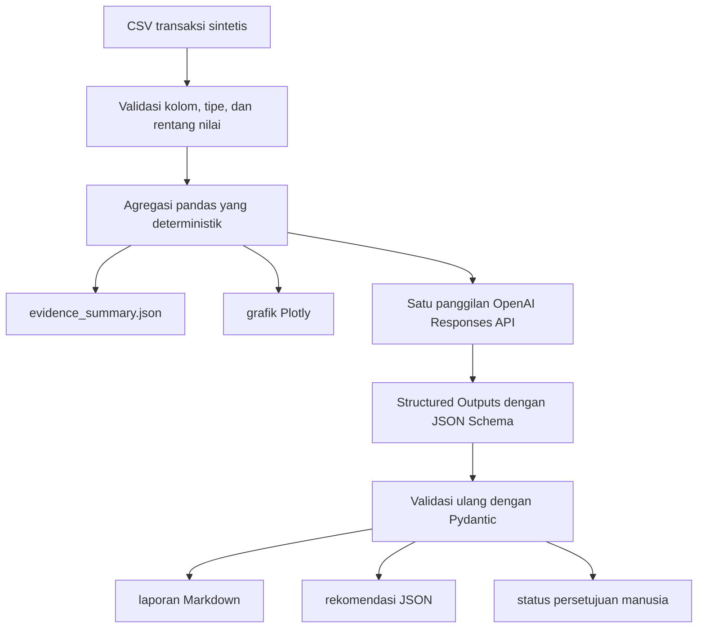

# Week 06 - Day 03: Consuming and Presenting AI Output

[](#)
[](#)
[](#)
[](https://github.com/astral-sh/uv)
[](https://www.python.org/)

Dalam hands-on ini, peserta berperan sebagai **AI Engineer** pada tim analitik retail. Peserta akan menjalankan pipeline yang mengubah data transaksi menjadi tiga bentuk output yang siap digunakan:

- **Visual:** grafik profit per kategori dan wilayah.
- **Naratif:** laporan Markdown berbahasa Indonesia yang bersumber dari evidence (bukti data) yang sudah dihitung.
- **Dapat ditindaklanjuti:** rekomendasi JSON tervalidasi yang tidak langsung menjalankan aksi eksternal.

Hands-on ini berbentuk **panduan langkah demi langkah**. Peserta tidak perlu menulis atau mengubah kode. Peserta cukup menyiapkan lingkungan kerja, menjalankan proyek, memeriksa artefak, dan membuktikan bahwa guardrail menolak output yang tidak diizinkan.

> **Titik Pemeriksaan Akhir:** Hands-on selesai ketika pipeline berhasil dijalankan, seluruh artefak tersedia, dan demo validasi menampilkan `DITOLAK SESUAI HARAPAN`.

## Cara Menggunakan Panduan Ini

Pada eksekusi pertama, peserta mengikuti Bagian 5 sampai Bagian 17 secara berurutan. Jika mengalami kebingungan, peserta kembali ke titik pemeriksaan terakhir yang berhasil lalu menggunakan peta cepat berikut.

| Jika peserta mengalami kebingungan tentang... | Buka bagian... |
|---|---|
| Penyiapan dependensi dengan uv | Bagian 5 |
| API key dan pemilihan model | Bagian 9 |
| Kegagalan unit test | Bagian 10 dan 19 |
| Cara menjalankan pipeline | Bagian 11 |
| Arti setiap file hasil | Bagian 12 sampai 16 |
| Penolakan output yang tidak valid | Bagian 17 |
| Kegagalan API | Bagian 18 dan 19 |
| Pembersihan lingkungan | Bagian 20 |

> **Petunjuk:** Peserta tidak perlu mengulang panggilan API sebelum penyebab kegagalan ditemukan. Evidence dan grafik yang sudah terbentuk tetap dapat diperiksa.

## 1. Tujuan Pembelajaran

Setelah menyelesaikan hands-on ini, peserta dapat:

1. Menjelaskan perbedaan output visual, naratif, dan dapat ditindaklanjuti.
2. Menunjukkan bahwa evidence dihitung kode sebelum dikirim ke model.
3. Mengonsumsi output terstruktur dari OpenAI Responses API.
4. Menunjukkan bagaimana JSON Schema dan Pydantic membatasi bentuk output.
5. Menjelaskan mengapa output valid belum boleh otomatis menjalankan aksi berisiko.

## 2. Cara Kerja Pipeline



> **Catatan Produksi:** Proyek ini merupakan implementasi edukasional. Sistem produksi masih membutuhkan autentikasi, observabilitas, mekanisme percobaan ulang yang terkendali, versioning prompt/skema, layanan persetujuan, dan audit log yang lebih kuat.

## 3. Prasyarat

Peserta menyiapkan:

- Python 3.11 atau lebih baru.
- `uv` (package manager Python).
- Akses terminal PowerShell, Bash, atau terminal serupa.
- Internet aktif.
- OpenAI API key yang memiliki akses ke model yang dikonfigurasi.
- Anggaran API untuk satu panggilan model per eksekusi.

Peserta dapat memeriksa versi `uv` dan Python dengan:

```bash
uv --version
python --version
```

> **Catatan:** Ketersediaan model dan batas penggunaan bergantung pada project serta tingkat penggunaan akun API peserta. Jika `gpt-5.6-luna` tidak tersedia, instruktur dapat memberikan model pengganti yang mendukung Responses API dan Structured Outputs.

## 4. Struktur Folder

```text
week_6_day_3_consuming_and_presenting_ai_output/
├── data/
│   └── retail_transactions.csv
├── src/
│   ├── __init__.py
│   ├── main.py
│   ├── pipeline.py
│   ├── schemas.py
│   └── validation_demo.py
├── tests/
├── .env.example
├── pyproject.toml
└── README.md
```

| File | Tanggung jawab |
|---|---|
| `data/retail_transactions.csv` | Dataset sintetis lokal tanpa data pribadi |
| `src/main.py` | CLI yang dijalankan peserta |
| `src/pipeline.py` | Validasi, evidence, grafik, API, dan proses rendering |
| `src/schemas.py` | Kontrak Pydantic dan daftar aksi yang diizinkan |
| `src/validation_demo.py` | Demonstrasi penolakan payload yang tidak diizinkan |
| `tests/` | Verifikasi offline tanpa memakai API key |
| `pyproject.toml` | Konfigurasi proyek dan dependensi uv |

## 5. Penyiapan Dependensi dengan `uv`

Buka terminal (PowerShell, Bash, atau Zsh), masuk ke direktori proyek ini, lalu lakukan sinkronisasi dependensi:

```bash
uv sync
```

Perintah di atas akan secara otomatis membuat virtual environment `.venv` terisolasi dan menginstal seluruh dependensi yang tertera pada `pyproject.toml`.

## 9. Konfigurasi OpenAI API

### Windows PowerShell

Peserta menyalin template konfigurasi environment:

```powershell
Copy-Item .env.example .env
```

### macOS atau Linux

```bash
cp .env.example .env
```

Peserta membuka `.env`, lalu mengganti placeholder berikut:

```text
OPENAI_API_KEY=masukkan-api-key-di-sini
OPENAI_MODEL=gpt-5.6-luna
```

> **Catatan Keamanan:** Peserta tidak boleh memasukkan `.env` ke Git, menampilkan API key pada tangkapan layar, atau menyalin key ke source code maupun notebook.

> **Catatan Biaya:** Setiap eksekusi pipeline melakukan satu panggilan API. Peserta tidak perlu menjalankan perintah berulang kali tanpa tujuan.

## 10. Titik Pemeriksaan Awal — Jalankan Unit Test

Sebelum menggunakan API, peserta memeriksa komponen lokal:

```bash
uv run pytest -q
```

Pengujian menggunakan klien tiruan. Perintah ini tidak membaca API key dan tidak menimbulkan biaya model.

**Hasil yang diharapkan:** seluruh pengujian berstatus `passed`.

> **Titik Pemeriksaan:** Jika pengujian gagal, peserta menghentikan proses dan membuka Bagian 19 sebelum menjalankan API.

## 11. Jalankan Pipeline Lengkap

Dari direktori proyek, peserta menjalankan:

```bash
uv run python -m src.main --input data/retail_transactions.csv --output outputs
```

Terminal akan menampilkan urutan status seperti:

```text
[1/5] Memvalidasi dataset retail...
[2/5] Menghitung evidence dan membuat chart...
[3/5] Meminta structured output dari model gpt-5.6-luna...
[4/5] Memvalidasi dan merender output AI...
[5/5] Selesai. Tidak ada aksi eksternal yang dieksekusi.
Status rekomendasi: awaiting_human_approval
```

Output AI dapat berbeda pada setiap eksekusi, tetapi struktur file dan field harus konsisten.

> **Titik Pemeriksaan:** Terminal tidak boleh menyatakan bahwa notifikasi, refund, routing, atau aksi eksternal lain telah dijalankan.

## 12. Pemeriksaan Evidence

Peserta membuka:

```text
outputs/evidence_summary.json
```

Peserta memeriksa bagian berikut:

- `row_count`
- `total_sales`
- `total_profit`
- `profit_margin`
- `average_discount`
- kategori dan wilayah dengan profit terendah
- tabel agregasi `category_summary` dan `region_summary`

Peserta memastikan bahwa angka tersebut berasal dari perhitungan pandas, bukan hasil perhitungan model.

> **Titik Pemeriksaan:** Peserta dapat menjelaskan kalimat: “Kode menghitung fakta; model membantu menyajikan fakta.”

## 13. Pemeriksaan Output Visual

Peserta membuka file berikut di browser:

```text
outputs/profit_by_category.html
outputs/profit_by_region.html
```

Peserta menjawab pertanyaan berikut:

1. Kategori mana yang memiliki profit terendah?
2. Wilayah mana yang memiliki profit terendah?
3. Apakah jawaban peserta sama dengan isi `evidence_summary.json`?
4. Keputusan apa yang dapat dibantu oleh masing-masing grafik?

> **Kesalahan Umum:** Grafik yang terlihat rapi belum tentu benar. Peserta tetap perlu membandingkannya dengan agregasi sumber.

## 14. Pemeriksaan Output Terstruktur Mentah

Peserta membuka:

```text
outputs/raw_ai_output.json
```

Peserta memeriksa lima bagian utama:

- `executive_summary`
- `key_findings`
- `recommendations`
- `limitations`
- `action`

Setiap item dalam `key_findings` harus memiliki `evidence_keys`. Peserta mencocokkan setiap key dengan `evidence_summary.json`.

> **Titik Pemeriksaan:** Tidak ada field tambahan di luar skema dan tidak ada aksi di luar daftar yang diizinkan.

## 15. Pemeriksaan Output Naratif

Peserta membuka:

```text
outputs/narrative_report.md
```

Peserta memastikan laporan memiliki:

- Ringkasan eksekutif.
- Temuan utama beserta evidence key dan nilainya.
- Rekomendasi.
- Batasan.
- Peringatan bahwa evidence agregat tidak membuktikan sebab-akibat.

Peserta menandai setiap kalimat sebagai fakta, interpretasi, rekomendasi, atau klaim yang tidak didukung. Jika menemukan klaim yang tidak didukung, peserta mencatatnya untuk diskusi dan tidak menganggapnya sebagai fakta.

## 16. Pemeriksaan Output yang Dapat Ditindaklanjuti

Peserta membuka:

```text
outputs/action_recommendation.json
outputs/action_status.json
```

Aksi yang diizinkan hanya:

- `review_low_profit_category`
- `review_regional_performance`
- `monitor_only`

Jika aksi bukan `monitor_only`, file status harus berisi:

```json
{
  "status": "awaiting_human_approval",
  "executed": false
}
```

> **Catatan Keamanan:** Model hanya memberi sinyal keputusan. Aplikasi tetap mengendalikan izin dan eksekusi.

## 17. Jalankan Demo Penolakan Output Tidak Valid

Peserta menjalankan:

```bash
uv run python -m src.validation_demo
```

Demo mencoba memasukkan action, priority, owner, dan evidence key yang tidak diizinkan.

**Hasil yang diharapkan:**

```text
DITOLAK SESUAI HARAPAN
Field bermasalah:
- action.action
- action.evidence_keys.0
- action.owner
- action.priority
Tidak ada aksi eksternal yang dijalankan.
```

> **Titik Pemeriksaan:** Peserta dapat menjelaskan bahwa validasi skema memeriksa bentuk dan nilai yang diizinkan, tetapi tinjauan manusia tetap diperlukan untuk menilai kebenaran dan kelayakan bisnis.

## 18. Apa yang Terjadi Jika API Gagal?

Pipeline sengaja membuat evidence dan grafik sebelum meminta output AI. Jika API key salah, akses model ditolak, jaringan gagal, atau batas penggunaan tercapai:

- Proses berhenti dengan exit code non-zero.
- `evidence_summary.json` dan grafik tetap tersedia.
- Narasi dan rekomendasi palsu tidak dibuat.
- Tidak ada aksi eksternal yang dijalankan.

Setelah penyebabnya diperbaiki, peserta menjalankan kembali perintah utama.

## 19. Panduan Pemecahan Masalah

| Masalah | Kemungkinan penyebab | Solusi |
|---|---|---|
| `uv` atau `python` tidak ditemukan | `uv` atau Python belum terpasang atau belum ada di PATH | Instal `uv` / Python 3.11+ dan buka terminal baru |
| `ModuleNotFoundError` | Environment belum tersinkronisasi | Jalankan `uv sync` |
| `OPENAI_API_KEY belum diatur` | `.env` belum dibuat atau masih placeholder | Salin `.env.example`, isi key, lalu jalankan ulang |
| Authentication error | API key salah, kedaluwarsa, atau tidak memiliki izin | Periksa key dan project API yang aktif |
| Model tidak tersedia | Akun tidak memiliki akses ke model | Gunakan model pengganti dari instruktur melalui `OPENAI_MODEL` |
| Rate limit | Batas request atau token tercapai | Tunggu, kurangi eksekusi berulang, atau periksa tingkat penggunaan akun |
| Structured output ditolak | Respons tidak lolos skema/Pydantic | Jangan menjalankan aksi; simpan error untuk investigasi |
| Chart tidak tampil | Browser tidak dapat memuat Plotly CDN | Pastikan internet aktif atau coba browser lain |

## 20. Pembersihan

Jika instruktur meminta pembersihan artefak runtime, peserta dapat menghapus folder `outputs/` dan `.venv/`. Source code dan dataset tetap dipertahankan. File `.env` harus tetap lokal dan tidak ikut dikumpulkan.

## 25. Referensi Resmi

- [OpenAI Responses API](https://developers.openai.com/api/reference/resources/responses/methods/create)
- [OpenAI Structured Outputs](https://developers.openai.com/api/docs/guides/structured-outputs)
- [Model GPT-5.6 Luna](https://developers.openai.com/api/docs/models/gpt-5.6-luna)
